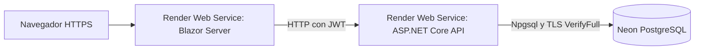

# Despliegue en Neon y Render — revisión V2

Estado: **preparación local verificada; despliegue externo pendiente**. No se ha publicado esta revisión ni transferido datos de MonsterASP. Fecha de referencia: 2026-11-13, America/Bogota. El estado más reciente está en ASTRA_ESTADO_TRABAJO.md.

## Arquitectura final preparada



Dos **Web Services Docker**; Blazor Server requiere un servidor .NET y WebSocket. El frontend no es un Static Site y no tiene acceso directo a la base. Se conserva el proveedor SQL Server por defecto y el compose de desarrollo existente; `BaseDatos__Proveedor=Postgres` selecciona los 30 repositorios paralelos. Servicios/modelos/controladores no cambian de contrato.

## Servicios y URLs comprobadas

| Recurso | Estado observado |
|---|---|
| Frontend de esta revisión en Render | Sin URL pública verificada; pendiente crear/desplegar |
| Backend de esta revisión en Render | Sin URL pública verificada; pendiente crear/desplegar |
| Neon | Sin proyecto/base verificados. El conector devolvió Unknown tool y dejó de estar disponible |
| Render | Conector operativo; workspace My Workspace disponible. create_blueprint devolvió HTTP 400: no pudo acceder al repositorio, rama o archivo privado. No se obtuvo ID de blueprint ni servicio nuevo. Autorizar MrEpia/innovacioncurricular en la integración Git de Render; no publicar el repo ni incrustar tokens. El servicio preexistente inventario pertenece a otro repositorio y no se modifica |
| Laboratorio API PostgreSQL | http://127.0.0.1:18072 (solo local, no es una URL de producción) |
| Laboratorio frontend | http://127.0.0.1:18073 (solo local) |
| MonsterASP anterior | URLs históricas en README.md; no se alteraron ni se presentan como el nuevo despliegue |

La base local tiene 25 tablas funcionales, 24 claves foráneas, claves simples/compuestas y el historial `astra_migraciones`. Hay tres migraciones obligatorias y una opcional con datos ficticios. Esto prueba PostgreSQL local, no prueba Neon. No se ha realizado una exportación de datos de producción.

## Runtime, compilación y arranque

Runtime: ASP.NET Core .NET 10. API: Dapper 2.1.35, Npgsql 10.0.0, SqlClient 5.2.2, JwtBearer 10.0.13 y Swashbuckle 6.6.2. Frontend sin paquetes externos de acceso a datos.

Los Dockerfile.render ejecutan `dotnet restore` y `dotnet publish -c Release`, copian solo la publicación a `mcr.microsoft.com/dotnet/aspnet:10.0` y arrancan como usuario `app`. No usan dotnet watch. Comandos desde la raíz:

```powershell
docker build -f api_innovacion/Dockerfile.render -t astra-innovacion-api:v2 .
docker build -f front_blazor/Dockerfile.render -t astra-innovacion-front:v2 .
```

Inicio: `dotnet ApiInnovacion.dll` y `dotnet FrontInnovacion.dll`. Ambos respetan `PORT`; API conserva 8072 como valor local. `.dockerignore` excluye secretos, Git, bin/obj y fuentes del curso de la imagen. No se usa un host local en la configuración de Render.

## Variables de entorno (sin secretos)

| Variable | Uso |
|---|---|
| `BaseDatos__Proveedor` | `Postgres` en el servicio nuevo; `SqlServer` por defecto |
| `ConnectionStrings__Postgres` | Cadena Npgsql privada con host, base, rol y contraseña de Neon; `SSL Mode=VerifyFull` obligatorio fuera de Development |
| `Jwt__Secreto` | Firma HS256, mínimo 32 caracteres; Render puede generarlo |
| `Jwt__Minutos`, `Jwt__Emisor`, `Jwt__Audiencia` | Opcionales, configuración JWT histórica |
| `AdminInicial__Usuario`, `AdminInicial__Correo`, `AdminInicial__Clave` | Bootstrap inicial; no sobrescribe un administrador activo existente |
| `UrlApi` | URL HTTPS real del backend en el frontend Render |
| `PORT`, `RENDER`, `ASPNETCORE_ENVIRONMENT` | Entorno del hosting; producción en Render |
| `Cors__Origenes__0` (y siguientes) | Opcional: orígenes exactos autorizados para clientes de navegador que llamen directamente a la API |
| `ConnectionStrings__SqlServer` | Solo proveedor histórico; no se migra su valor a Neon |

No se imprime ni versiona una cadena real. `publicacion/.env.neon.example` contiene solo marcadores. `.env.neon` y otros `.env.*` privados se ignoran. Una URI de Neon no es directamente una cadena Npgsql: ingresar sus campos mediante el constructor/formato Npgsql y conservar correctamente los caracteres especiales de contraseña.

## Procedimiento seguro para Neon

1. Restablecer el acceso autenticado a Neon y listar proyectos/ramas/bases existentes. No crear duplicados ni seleccionar producción por parecido de nombre.
2. Seleccionar un proyecto nuevo y separado con capacidad gratuita confirmada; no contratar planes ni ampliar cómputo pago. PostgreSQL 16 es la versión comprobada localmente. Si no hay capacidad gratuita, dejarlo pendiente.
3. Crear una base vacía y conservar el SQL Server original. La migración de datos reales requiere exportación, recuentos, verificación de claves y aceptación separada; este trabajo prepara esquema/semillas, no afirma que ya transfirió producción.
4. Guardar la conexión privada en `.env.neon`/secretos Render. Usar un endpoint directo para migraciones y uno apropiado para aplicación; verificar TLS y limitar el pool. No activar Neon Auth: la aplicación conserva su JWT y sus roles.
5. Ejecutar la migración y verificar tablas, 24 FK, restricciones, funciones, historial y acceso del backend real. Registrar IDs no secretos en el punto de control.

```powershell
docker run --rm --env-file .env.neon astra-innovacion-api:v2 --migrar-postgres
```

El migrador toma advisory lock, rechaza una base con tablas públicas sin historial ASTRA, registra checksum y aplica cada archivo en una transacción. Una migración aplicada se omite si coincide; un checksum diferente bloquea la ejecución. Crear otra migración para cambios posteriores; no editar las ya aplicadas. No ejecuta DROP, DELETE, TRUNCATE ni el script original de limpieza SQL Server.

`--datos-demo` agrega la semilla opcional ficticia; no usarla como sustituto de datos reales:

```powershell
docker run --rm --env-file .env.neon astra-innovacion-api:v2 --migrar-postgres --datos-demo
```

El migrador es una tarea explícita: no depende de un pre-deploy de pago ni corre automáticamente en cada instancia web. Si falla, la transacción pendiente se revierte; revisar SQLSTATE y el historial antes de repetir. Las pruebas de protección y concurrencia están en `pruebas_humo/validar_infra_postgres.py` y solo deben ejecutarse sobre un laboratorio Docker dedicado.

## Procedimiento para Render

1. Hacer fetch/status y comprobar esta rama y el PR. Subir los cambios de `deploy/neon-render-spec-kit-v2`; no usar main ni fusionar automáticamente.
2. Verificar servicios existentes. Usar `render.yaml` para dos recursos nuevos en plan free, región virginia, o crear ambos Web Services Docker con los mismos Dockerfile/contexto. El blueprint tiene despliegue automático desactivado; no adoptar servicios ajenos.
3. Cargar las variables privadas del backend, con Neon ya migrado. Desplegar y esperar el resultado del deploy. Comprobar `GET /health` = 200 (conexión + historial de las tres migraciones obligatorias), `GET /`, Swagger y login/consultas reales. La compilación sola no demuestra éxito.
4. Configurar `UrlApi` del frontend con la URL HTTPS efectiva del backend, desplegar el frontend y comprobar formulario de ingreso, páginas por rol, CRUD, reportes y dashboard. Verificar WebSocket de Blazor y cookie Secure en el hosting.
5. Registrar URLs/IDs/commit efectivo y los resultados públicos en este documento y el punto de control. Si hay autoDeploy activo en un servicio, no disparar un segundo deploy después del push; consultar primero sus deploys.

Los orígenes CORS quedan cerrados si no se configura una lista. El flujo Blazor habitual llama desde el servidor y no necesita CORS abierto. No habilitar comodines para el despliegue.

## Laboratorio local repetible

Preparar un archivo privado fuera del repositorio con `PG_PRUEBA_CLAVE`, `JWT_SECRETO`, `ADMIN_USUARIO`, `ADMIN_CORREO` y `ADMIN_CLAVE`. Ejecutar:

```powershell
docker compose -p astra-neon-v2 -f docker-compose.postgres.yml --env-file RUTA_PRIVADA up -d
docker compose -p astra-neon-v2 -f docker-compose.postgres.yml --env-file RUTA_PRIVADA run --rm migrar --migrar-postgres --datos-demo
```

El compose nuevo usa un volumen propio y los puertos 18072/18073 en loopback. No apagar ni recrear los contenedores históricos innovacion-api, innovacion-front o innovacion-sqlserver. No ejecutar `verificar_todo.py --limpio` sobre el entorno compartido.

Los scripts de humo aceptan `API_URL`, `FRONT_URL` y credenciales de prueba por entorno. Para comprobaciones SQL directas locales: `PRUEBAS_PG_CONTENEDOR`. Para la prueba que pausa la API: `PRUEBAS_API_SERVICIO`, `PRUEBAS_COMPOSE_ARCHIVO`, `PRUEBAS_COMPOSE_PROYECTO` y `PRUEBAS_ENV_ARCHIVO`, apuntando exclusivamente al laboratorio. El bloque usa finally para descongelar la API incluso si la comprobación falla.

## Errores, logs y actualizaciones

Consultar logs de build/runtime y la lista de deploys del servicio correcto en Render. `/health` devuelve 503 sin datos privados si la base no responde o falta historial. El frontend tiene una página `/Error` y no expone excepciones; la API oculta detalles internos de los 500 en producción y da una referencia. El bootstrap registra el tipo del error sin imprimir la excepción completa. Las credenciales nunca deben incluirse en consultas de logs ni copiarse a documentación.

Para actualizar: revisar cambios del equipo, crear commit en rama de trabajo, compilar, pasar pruebas, aplicar solo migraciones nuevas, subir la rama y desplegar el commit elegido. Revisar el despliegue activo y repetir pruebas públicas. Revertir el código al deploy anterior si falla; no revertir tablas o datos mediante scripts destructivos.

## Pruebas, límites y pendientes

Resultados detallados: `docs/VALIDACION_NEON_RENDER_V2.md`. Se distinguen pruebas locales de verificaciones externas. Render free puede suspender procesos y el frontend guarda sesiones/JWT en memoria: reinicios cierran sesiones; no hay escalamiento horizontal verificado. La conservación de claves DataProtection entre reemplazos no está configurada. No hay SLA ni mediciones de carga. Las pantallas PWA no prueban escritura autenticada offline.

Pendiente obligatorio: acceso Neon; proyecto/base reales y migraciones verificadas allí; servicios/URLs Render; HTTP público con frontend-backend-Neon; revisión del equipo del PR. Hasta entonces la misión permanece incompleta.

## Referencias primarias

- [Npgsql: ejecución y conexiones](https://www.npgsql.org/doc/basic-usage.html)
- [Npgsql: TLS y certificados](https://www.npgsql.org/doc/security.html)
- [Render: especificación Blueprint](https://render.com/docs/blueprint-spec)
- [Codex: trabajo prolongado](https://learn.chatgpt.com/docs/long-running-work)

### Repetir pruebas de infraestructura y runtime

```powershell
python pruebas_humo/validar_infra_postgres.py --env-file RUTA_PRIVADA --trabajo DIRECTORIO_FUERA_DEL_REPO
python pruebas_humo/validar_runtime_produccion.py --trabajo DIRECTORIO_FUERA_DEL_REPO
python publicacion/generar_mapa_v2.py --swagger-url http://127.0.0.1:18072/swagger/v1/swagger.json
```

La prueba de infraestructura crea dos bases nuevas en el laboratorio astra-, sin borrar ninguna. La prueba de runtime crea y detiene su propio contenedor desechable sin volumen; usa un puerto asignado por Docker. Para repetir las pruebas de capas, construir el target `build` del Dockerfile.render de la API y ejecutar `dotnet run --project api_innovacion/pruebas/PruebaCapas.csproj -c Release` en esa imagen SDK.
