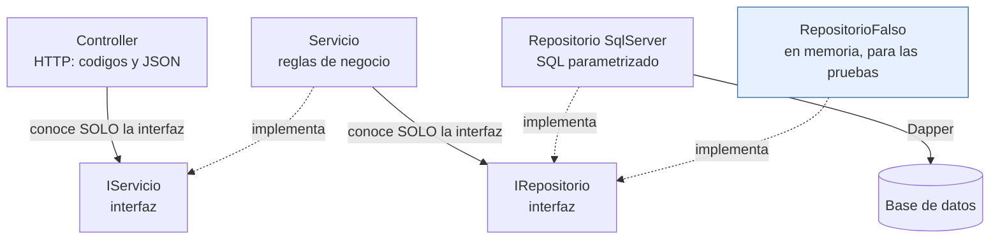

# Constitución del proyecto — Módulo Innovación Curricular

> **Documento permanente.** Estas reglas rigen TODAS las versiones del
> proyecto. Cada versión tiene además su propia especificación en
> [versiones/](versiones/0_mapa_versiones.md); ante conflicto, la
> constitución gana.
>
> Este proyecto es el **ejemplo de referencia** del módulo Innovación Curricular
> de los proyectos de aula. El QUÉ del módulo está en
> [modulo_innovacion_curricular.md](../../ProyectosDeAula/docs/modulo_innovacion_curricular.md)
> y el CÓMO se trabaja, en
> [0_METODOLOGIA.md](../../ProyectosDeAula/docs/0_METODOLOGIA.md).

---

## Artículo 1 — El proyecto se construye POR VERSIONES y la especificación manda

- El sistema crece por **versiones incrementales** (v1, v2, …), cada una
  con su spec kit propio. Una versión está TERMINADA solo cuando pasa sus
  criterios de aceptación; entonces se hace commit, **tag** (`v1`, `v2`…)
  y solo después se escribe la spec de la siguiente.
- **No se anticipa** (**YAGNI**, *You Aren't Gonna Need It* — "no lo vas a
  necesitar"): nada de JWT en la v1, ni dashboard en la v2, ni tablas de
  más antes de la versión que las pida. El código de cada versión solo
  puede nombrar lo que su spec nombra.
- **Cerrado es cerrado:** una versión con tag no se reabre; los ajustes van
  a la siguiente.
- Si el código hace algo que la spec no dice, sobra; si la spec pide algo
  que el código no hace, falta.

## Artículo 1.1 — Una versión incluye SU FRONT

**Cada versión entrega su parte de la API *y* su parte del front.** No hay una
versión «de back» y otra «de front».

> **La regla operativa: una versión NO está cerrada si la API responde y la
> pantalla no.** Media versión no es una versión.

### Por qué

| | |
|---|---|
| **Lo terminado se le puede mostrar a alguien** | Una versión que solo trae endpoints se sustenta con Swagger. Una que trae pantallas se le muestra a quien la pidió |
| **El contrato se ejercita de inmediato** | Uno descubre que el JSON es incómodo **cuando le toca pintarlo**. Si el front llega tres versiones después, el contrato lleva tres versiones equivocado |
| **No hay front de golpe al final** | Es el error que se paga caro: seis entidades de API esperando un front que nace con una sola, y una versión entera dedicada a que se alcancen |
| **Es lo que pide el curso** | `0_METODOLOGIA.md` §2, textual: *«v1 — CRUD de las tablas sin FK del módulo — **API REST + Frontend funcionando**»* |

Y lo que cuesta, que también hay que decirlo: **cada versión es el doble de
grande** y cada compuerta revisa dos stacks. Se compensa recortando el alcance:
esta v1 toma **una** tabla, no veintidós.

### El front es un TERCER PROCESO

**Blazor Server**, en su propio proyecto y en su propio contenedor, hablando
con la API **solo por HTTP**. Tres cosas que se comprueban, no que se prometen:

1. Su `FrontInnovacion.csproj` **no tiene ningún paquete de acceso a
   datos**.
2. Su servicio en el compose **no depende de `sqlserver`** ni recibe su
   cadena de conexión.
3. Y la prueba: **apagando la API, la pantalla sigue en pie**, con su aviso y
   **sin un solo dato**. Es la sección 5 de `pruebas_humo/humo_front.py`.

### Y no comparte código con la API, aunque los dos estén en C#

Se podría referenciar el proyecto de la API y usar sus clases: `Aliado` existe en
los dos lados, con los mismos campos. **No se hace.** El front tiene la suya,
que se parece a la de la API porque el contrato es el mismo — no porque sea la
misma.

Compartirlas ataría los dos procesos: renombrar una propiedad dentro de la API
rompería el front **sin que nadie tocara el contrato HTTP**. Lo único que
comparten es el JSON.

> Con el front en otro lenguaje esto sería imposible y no habría nada que
> cuidar. Aquí la tentación existe todos los días, y por eso es un artículo.

### La pantalla habla el idioma del usuario

Ni verbos HTTP, ni códigos de estado, ni nombres de tabla. Los dos botones de
guardar se llaman **«Guardar la ficha completa»** y **«Guardar solo lo que
cambié»**: que uno mande un reemplazo y el otro una modificación parcial es
asunto del programa, no de quien usa el sistema.

## Artículo 2 — Stack: C# y ASP.NET Core, con el SQL a la vista

- Lenguaje **C#** sobre **ASP.NET Core** (.NET 10): controladores con
  atributos, inyección de dependencias del framework y `async/await` en
  todo el acceso a datos.
- **SIN ORM de entidades** (sin Entity Framework): el SQL se escribe
  A MANO, visible y **SIEMPRE parametrizado** (`@parametro` — jamás
  concatenar valores). El ejecutor es **Dapper**, un micro-ejecutor sobre
  ADO.NET: mapea fila→objeto pero nunca genera SQL por nosotros. Si una
  consulta existe, está escrita en el repositorio y se puede leer.
- Paquetes permitidos, y ninguno más sin que una spec lo pida:
  `Microsoft.Data.SqlClient` (el cliente del motor), `Dapper` y
  `Swashbuckle.AspNetCore` (Swagger). *(Enmienda 1.2.0)* Desde la v3,
  también `Microsoft.AspNetCore.Authentication.JwtBearer`, para validar los
  tokens. Las contraseñas se hashean con PBKDF2 de .NET: sin paquete.

## Artículo 3 — Arquitectura en tres capas con interfaces, desde el día 1

```
HTTP → Controller (valida el body contra la PETICIÓN del verbo → 422)
     → IServicio<Entidad>       (interfaz — reglas de negocio)
     → IRepositorio<Entidad>    (interfaz — el servicio no sabe qué motor hay)
     → Repositorio<Entidad>SqlServer  (Dapper, SQL a mano parametrizado)
     → la base de datos
```

- El controlador no toca SQL; el servicio no conoce HTTP ni el motor; el
  repositorio no conoce HTTP. Los contratos entre capas son `interface`
  de C#.
- **Solo el ensamblador** conoce clases concretas. Todo lo demás recibe
  interfaces por constructor. *(Enmienda 1.1.0)* El ensamblador puede
  repartirse en archivos de `Ensamblador/` —uno por bloque de trabajo, en la
  API y en el front— que `Program.cs` solo invoca. Sigue siendo **un**
  ensamblador: repartido en archivos para que tres personas no editen
  `Program.cs` en la misma ronda, no en responsabilidades.
- El negocio comunica problemas con **excepciones**
  (`ArgumentException` → 400 · `NoEncontradoExcepcion` → 404) y el
  controlador las traduce a HTTP.

**La regla, dibujada.** Las flechas son las ÚNICAS dependencias
permitidas: cruzar capas o saltárselas viola la constitución.



Fíjese en el repositorio falso: como el servicio solo conoce la interfaz,
se le puede enchufar uno de mentiras y probarlo **sin base de datos**. Esa
prueba es un criterio de aceptación, no un adorno.

## Artículo 4 — Un solo comando

`docker compose up -d --build` deja TODO el sistema de la versión
funcionando, desde la primera versión. Sin pasos manuales y sin instalar
nada local más allá de Docker. El código va montado como volumen y corre
con `dotnet watch`: guardar un `.cs` recompila y reinicia solo.

## Artículo 5 — La base de datos viene DADA

- La base `innovacion_local` se crea **completa, con sus 25 tablas**, desde
  la v1, a partir del script provisto en `db/`. Se copia, no se genera.
- Los datos de los catálogos salen del Excel de referencia del módulo.
- Lo que crece por versiones es **la API**, no la base. El código de cada
  versión solo puede nombrar las tablas que su spec le permite.

## Artículo 6 — Borrado LÓGICO, siempre

- `DELETE` **nunca** borra la fila: marca `activo = 0`.
- Todos los listados **filtran los inactivos** por defecto.
- Toda tabla del módulo tiene su columna `activo BIT NOT NULL DEFAULT 1`.

Es regla de la metodología del proyecto de aula y de su rúbrica: un
borrado físico reprueba el criterio.

## Artículo 7 — Los secretos van en variables de entorno

**La regla del proyecto de aula:** ningún secreto —cadena de conexión,
contraseña de la base, secreto de firma del JWT— va escrito en el código
ni en archivos versionados. Van en **variables de entorno**, con el `.env`
fuera de git y un `.env.example` adentro. En la rúbrica, un secreto
quemado **anula el criterio de seguridad de la versión**.

**La excepción de la plantilla ya no aplica** *(enmienda 1.1.0)*. El ejemplo
de referencia del curso dejaba la contraseña de SQL Server escrita en el
`docker-compose.yml` y en el `appsettings.json` por didáctica, y el propio
artículo advertía que *esa parte no se copia*. Este repositorio es el
proyecto de aula del equipo —se publica en la v4— y desde la v2 cumple la
regla completa:

- Todos los secretos (contraseña de `sa`, y desde la v3 la llave de firma del
  JWT y la clave del administrador inicial) viven en `.env`, que está en el
  `.gitignore`.
- El repositorio trae `.env.example` con las mismas variables y valores de
  mentira.
- `docker-compose.yml` los lee con `${VARIABLE:?mensaje}`: si falta uno,
  compose se niega a arrancar y dice cuál, en vez de levantar un sistema sin
  clave.
- `appsettings.json` no trae cadena de conexión con contraseña: la API la
  recibe por la variable `ConnectionStrings__SqlServer`.

El precio, que también se dice: «un solo comando» pasa a ser **uno más uno**
—copiar el `.env.example` la primera vez—. Es el precio de que la contraseña
esté en un solo sitio y fuera de git.

## Artículo 8 — Todo en español, y el código sustenta sus decisiones

- Nombres, rutas, mensajes, comentarios y documentación: **en español**.
- Los comentarios explican **por qué** está hecho así —la decisión y su
  consecuencia—, no qué hace cada palabra del lenguaje. Un comentario que
  repite la línea de abajo sobra; uno que explica por qué el repositorio
  no conoce HTTP, no.
- Se prefiere lo explícito sobre la metaprogramación compacta, y no por
  didáctica: este código se revisa en Pull Requests y se sustenta
  oralmente, así que tiene que poder leerse sin descifrarlo.

## Artículo 9 — Contratos exactos

Los endpoints, formatos y códigos de estado de cada versión están en su
`6_contracts.md` y se cumplen **al pie de la letra** — incluido el
contraste didáctico `PUT` (reemplazo completo → 422 si falta un campo) vs
`PATCH` (parcial → 200 con el mismo cuerpo). El error también es contrato:
un 404 o un 422 tienen su formato exacto documentado.

## Artículo 10 — Convenciones fijas

| Cosa | Convención |
|---|---|
| Puertos del proyecto | API **8072** · **front 8073** · SQL Server **11471** |
| Base de datos | `innovacion_local` |
| Rutas | `/` (diagnóstico) · `/swagger` (documentación interactiva) · `/api/{tabla}` |
| Nombres | PascalCase en español; interfaces con prefijo `I`; carpetas `Controllers/ Modelos/ Peticiones/ Servicios/ Repositorios/ Excepciones/ pruebas/` (`Modelos/` = clases entidad; `Peticiones/` = el cuerpo de cada verbo) |
| Sobre de respuesta | Lecturas: `{tabla, limite, total, datos}` · Errores: `{estado, mensaje, detalle}` (+ `errores:[…]` en el 422) |
| Errores | Cuerpo inválido (la petición) → **422** · `ArgumentException` → **400** (incluye `ReferenciaInvalidaExcepcion`: una clave foránea que no apunta a un registro activo) · `NoEncontradoExcepcion` → **404** · `LlaveDuplicadaExcepcion` y `DependenciasActivasExcepcion` → **409** *(enmienda 1.1.0)* · `SqlException` y demás → **500** · lectura sin filas → **204** |
| Creación | v1: **200** (versión cerrada, no se toca) · desde la v2: **201** con la llave creada *(enmienda 1.1.0)* |
| Seguridad | *(Enmienda 1.2.0)* Sin token, token inválido o vencido → **401** · rol insuficiente → **403**, ambos con el sobre `{estado, mensaje, detalle}`. Permisos por verbo: GET los tres roles · POST/PUT/PATCH administrador y editor · DELETE administrador. `usuario`, `rol` y `rol_usuario`, solo administrador |
| Credenciales | Usuario `sa`. **La contraseña no se escribe en este documento ni en ningún archivo versionado:** vive en el `.env` (Artículo 7) |

## Artículo 10.1 — Una ruta y un servicio por recurso, nunca genéricos

La API expone `/api/aliado`. **No existe ni existirá** un `/api/{tabla}` con
el nombre de la tabla como parámetro, y del lado del front hay un
`ServicioAliado`, no un `ApiService.Listar("aliado")`.

Lo genérico es más corto de escribir y más caro de vivir:

| | |
|---|---|
| **No puede validar** | Cada tabla tiene sus campos y sus reglas. Un endpoint que sirve para todas no puede exigir ninguno |
| **No puede documentarse** | ¿Qué campos pide `/api/{tabla}`? Swagger no lo sabe, y quien lo consume, tampoco |
| **Apaga el compilador** | `Listar("aliadoo")` compila. `ServicioAliado.Listar()` no deja escribir el error |
| **Vuelve el esquema un contrato** | Renombrar una columna deja de ser un cambio interno y pasa a romper a quien consume, en silencio |

*(Enmienda 1.1.0)* Lo que sí se comparte en el front es el **transporte**:
`ClienteApi` sabe enviar una petición, reconocer el 204 y traducir el sobre de
error, y nada más. Ninguna pantalla lo usa directamente: las pantallas
siguen hablando con `ServicioAliado`, `ServicioFacultad`…, que son los que
saben qué recurso existe, qué ruta lleva y qué campos tiene. Es al front lo
que `HttpClient` es a cualquier programa, no un `ApiService.Listar("aliado")`.

Cuando el módulo tenga más recursos habrá **un controlador, un servicio y una
pantalla por cada uno**. Se van a parecer mucho, y esa repetición es el precio
—consciente— de que cada recurso pueda decir lo suyo.


## Artículo 11 — Cómo se enmienda esta constitución

Una regla se cambia **solo** así: se propone en el `4_research.md` de la
versión que la necesita, con su razón y sus consecuencias; si se acepta,
esta constitución **sube de versión** y se anota la fecha de enmienda. No
se corrige "de una" ni se deja pasar por excepción: si un plan la viola,
o se corrige el plan, o se enmienda esto.

---

*Versión 1.2.0 · Ratificada el 2026-08-29 · Última enmienda: 2026-10-22*

### Registro de enmiendas

| Versión | Fecha | Artículos | Qué cambió y por qué | Dónde se propuso |
|---|---|---|---|---|
| 1.2.0 | 2026-10-22 | 2, 10 | Se permite el paquete JwtBearer y se agregan 401/403 y la tabla de permisos por verbo | [v3_seguridad/4_research.md](versiones/v3_seguridad/4_research.md), D-v3-1 y D-v3-4 |
| 1.1.0 | 2026-10-22 | 3, 7, 10, 10.1 | El ensamblador se reparte en `Ensamblador/` por bloque (tres estudiantes en paralelo) · se elimina la excepción de secretos de la plantilla: todo va en `.env` · se agregan los códigos 409 (llave duplicada, dependencias activas) y 201 (creación) para la v2 · el front comparte el transporte (`ClienteApi`), no los recursos | [v2_entrega2/4_research.md](versiones/v2_entrega2/4_research.md), D-v2-1 a D-v2-4 |

## Artículo 12 — La identidad visual es ARTEFACTO DADO

El sistema se construye para la **Universidad Monte Verde**, y esa
institución **ya decidió cómo se ve**. Su Manual de Identidad Visual
Corporativa está en la raíz del repositorio:
[`MANUAL_DE_MARCA.md`](../../MANUAL_DE_MARCA.md).

Igual que el esquema de la base, **el manual no se discute: se cumple.**

| | |
|---|---|
| Los valores del manual viven en | `front_blazor/wwwroot/marca.css` |
| Los estilos de la aplicación usan | `var(--umv-verde)`, nunca `#1F5E4C` |
| El logosímbolo está en | `marca/` |

**Tres reglas que salen del manual y son de obligado cumplimiento:**

1. **Los colores no se cambian.** El artículo tercero de la resolución que
   adopta el manual es explícito. Un color corporativo alterado es un
   defecto, no un detalle estético.
2. **El logosímbolo respeta su tamaño mínimo y su área de reserva**, y va
   sobre banda blanca: el manual no contempla versión negativa.
3. **Los colores de estado no son los institucionales.** Un error se marca
   en rojo alerta, no en ocre: un error en ocre se lee como decoración.

**Por qué `marca.css` está aparte de los estilos de la aplicación:** porque
son dos cosas distintas. Ahí van los **valores que fija el manual** —y que no
se pueden cambiar—; en el otro archivo, **cómo se usan**. El día que la
Universidad actualice su manual, se cambia un archivo y nada más.

> **Universidad Monte Verde es una institución inventada para el curso.** El
> manual está escrito como uno real porque el ejercicio es aprender a
> trabajar con una restricción de marca, que es lo que va a encontrar en
> cualquier organización.
>
> El porqué de todo esto, con la fórmula del contraste y las referencias,
> está en [`CONCEPTOS_IDENTIDAD_VISUAL.md`](../CONCEPTOS_IDENTIDAD_VISUAL.md).
