# Diagramas de secuencia — un diagrama por método

> Cada diagrama muestra **qué hace un método** recorriendo las capas reales del
> sistema (Artículo 3 de la [constitución](1_constitution.md)):
>
> `Front (Blazor)` → `ClienteApi` → **API**: `Controller` → `IServicio` →
> `IRepositorio` → `SQL Server`
>
> Los métodos CRUD tienen el **mismo nombre y el mismo recorrido en las 22
> tablas** del módulo (Artículo 10.1: un controlador, un servicio y un
> repositorio por tabla). Por eso se dibujan una vez, con la tabla como
> ejemplo; lo que cambia de una tabla a otra está en la nota de cada diagrama.
> Los contratos exactos (rutas, cuerpos, códigos) están en el `6_contracts.md`
> de cada versión.

## Índice

| # | Método | Capa de entrada | Versión |
|---|---|---|---|
| 1 | `ObtenerTodos` — listar | `XController.ObtenerTodos` | v1 |
| 2 | `ObtenerPorId` / `ObtenerPorLlave` — obtener uno | `XController.ObtenerPor…` | v1 · v2 |
| 3 | `Crear` | `XController.Crear` | v1 · v2 |
| 4 | `Reemplazar` (PUT) | `XController.Reemplazar` | v1 · v2 |
| 5 | `ActualizarParcial` (PATCH) | `XController.ActualizarParcial` | v1 · v2 |
| 6 | `Eliminar` — borrado lógico | `XController.Eliminar` | v1 · v2 |
| 7 | `ValidarReglas` — claves foráneas activas | `ServicioX` (privado) | v2 |
| 8 | Petición rechazada por el cuerpo (422) | framework | v1 |
| 9 | `PermisoPorVerbo` — autorización | filtro global | v3 |
| 10 | `IniciarSesion` — `POST /api/login` | `LoginController` | v3 |
| 11 | `ServicioUsuario.Crear` | `UsuarioController.Crear` | v3 |
| 12 | `ServicioUsuario.Eliminar` | `UsuarioController.Eliminar` | v3 |
| 13 | `ServicioRolUsuario.Asignar` / `Quitar` | `RolUsuarioController` | v3 |
| 14 | `AsegurarAdministradorInicial` | arranque de la API | v3 |
| 15 | Ingresar en el front (`/ingresar`) | `Ingresar.razor` | v3 |
| 16 | `ClienteApi.Enviar` — token y sesión vencida | front | v3 |
| 17 | Cerrar sesión (`/sesion/salir`) | `EnsambladorSesion` | v3 |

---

## 1. `ObtenerTodos` — listar

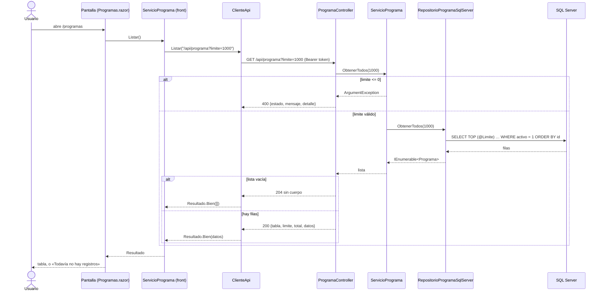

**Lo hace igual en las 22 tablas.** Solo cambian la ruta y las columnas del `SELECT`. Los inactivos nunca salen: el filtro `activo = 1` está en el SQL.

## 2. `ObtenerPorId` / `ObtenerPorLlave` — obtener uno

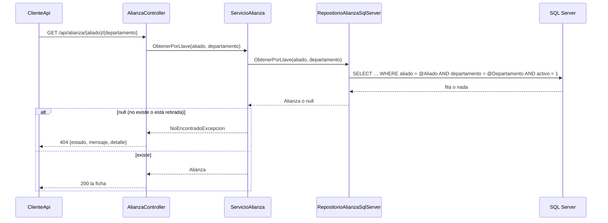

Con llave simple el método se llama `ObtenerPorId` (o `ObtenerPorResolucion`, `ObtenerPorCodigo`, `ObtenerPorNit`); con llave compuesta, `ObtenerPorLlave`, y la ruta lleva un segmento por columna.

## 3. `Crear`

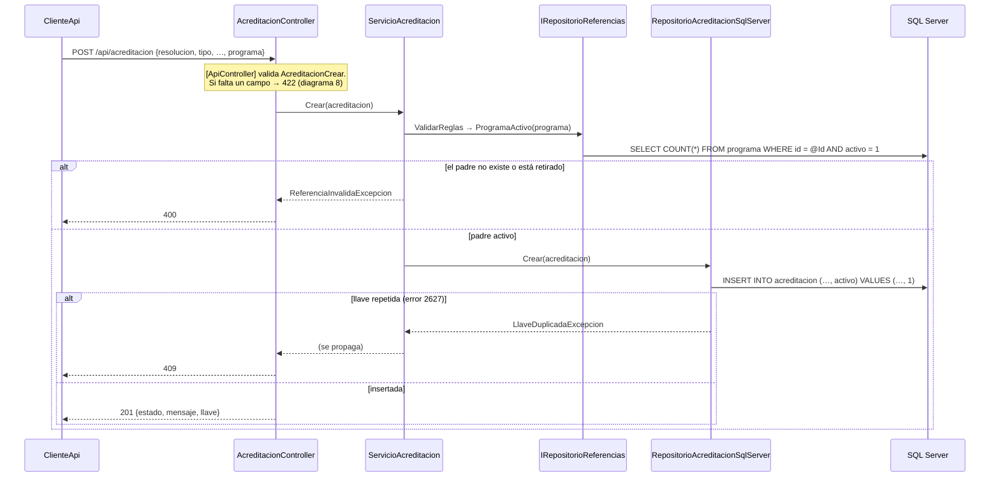

**v1:** las 7 tablas sin clave foránea no validan referencias y responden **200** (versión cerrada). **v2:** cada servicio valida SUS claves foráneas y sus reglas propias (diagrama 7) y responde **201**.

## 4. `Reemplazar` (PUT)

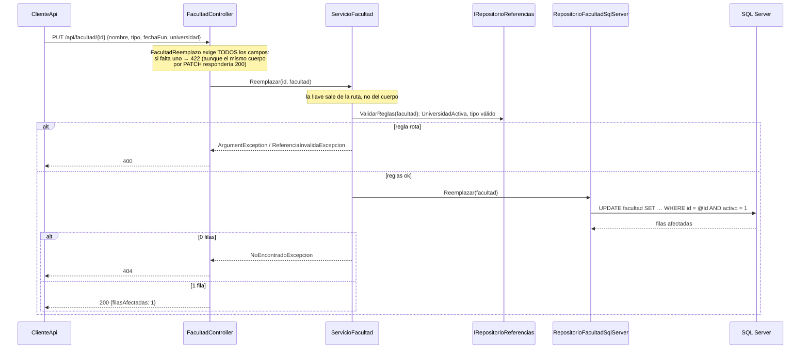

Las tablas puente sin columnas propias (`programa_ac`, `programa_pe`, `programa_ci`, `an_programa`, `enfoque_rc`, `rol_usuario`) **no tienen** este método.

## 5. `ActualizarParcial` (PATCH)

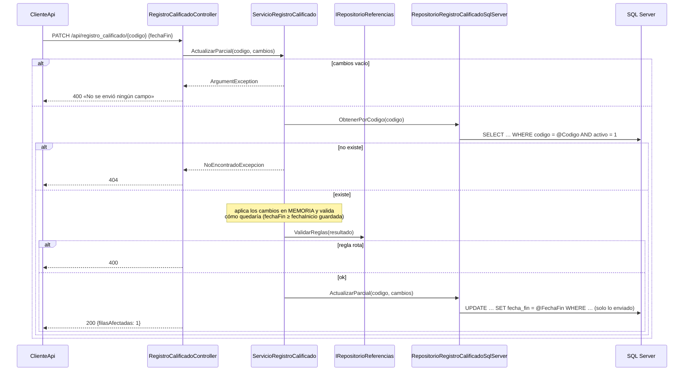

**v1:** valida solo que llegue algún campo. **v2:** además lee el registro y valida el resultado (D-v2-7).

## 6. `Eliminar` — borrado lógico

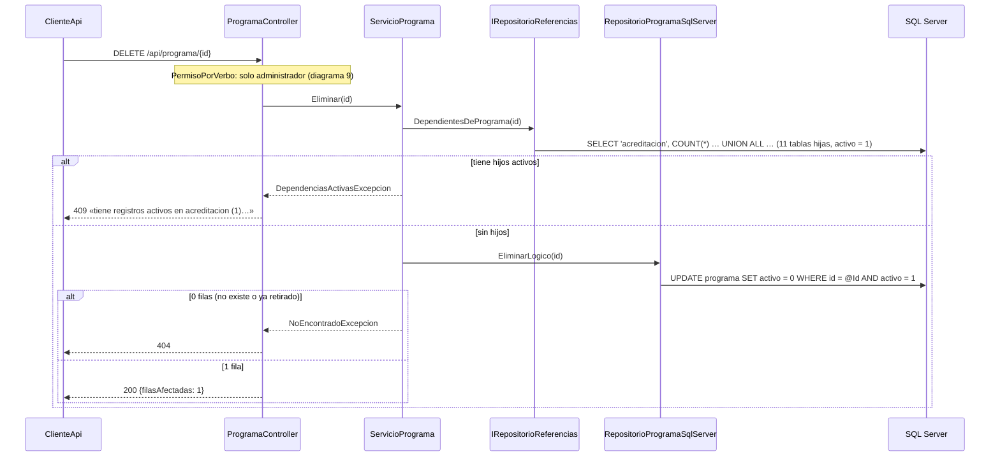

La fila **nunca** se borra (Artículo 6). Las tablas que no son padre de nadie se saltan la consulta de dependientes. Las 7 tablas de la v1 también la hacen desde la v2 (RF9).

## 7. `ValidarReglas` — claves foráneas activas (método privado de cada servicio v2)

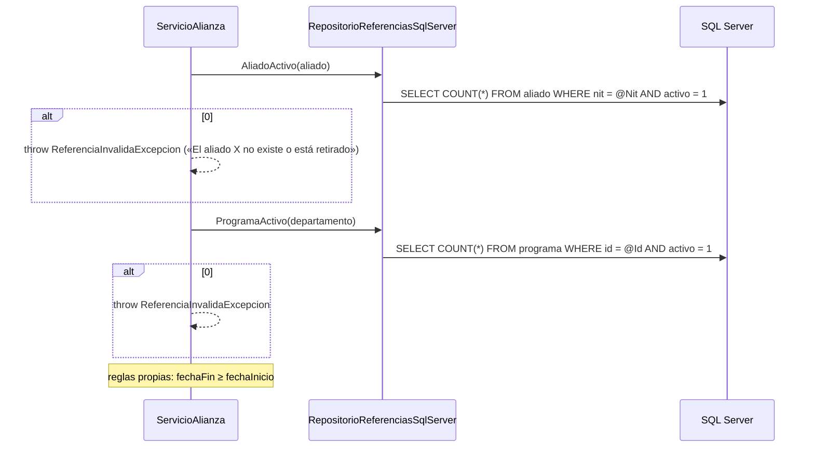

Lo llaman `Crear`, `Reemplazar` y `ActualizarParcial`. Cada tabla pregunta por SUS padres con un método explícito (Artículo 10.1); las claves opcionales (`activ_academica.disenio`) solo se validan si vienen.

## 8. Petición rechazada por el cuerpo (422)

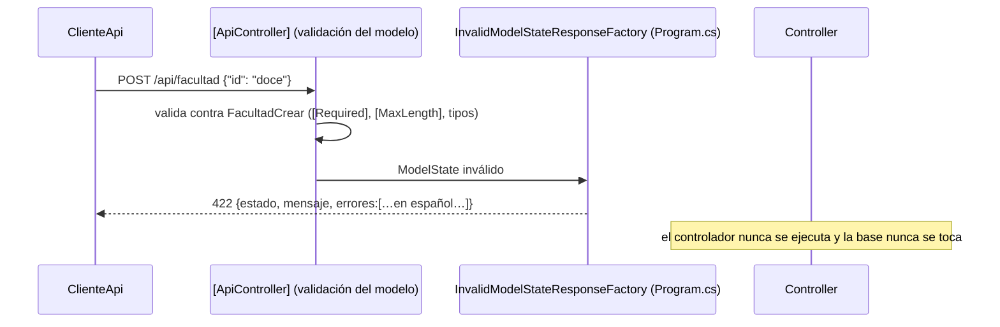

## 9. `PermisoPorVerbo` — autorización en cada petición

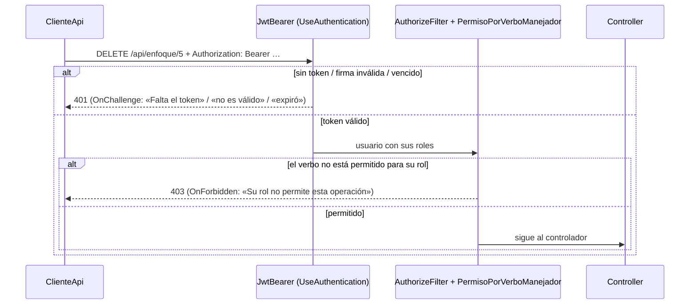

GET: los tres roles · POST/PUT/PATCH: administrador y editor · DELETE: administrador. `usuario`, `rol` y `rol_usuario` exigen además el rol administrador.

## 10. `IniciarSesion` — `POST /api/login`

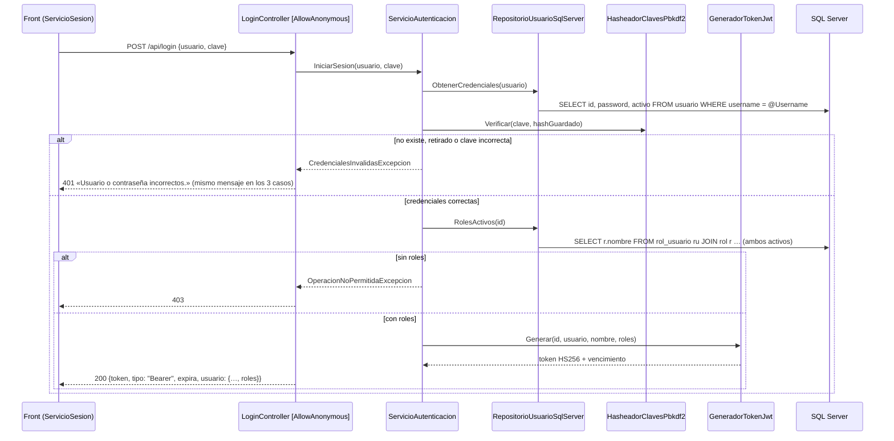

## 11. `ServicioUsuario.Crear`

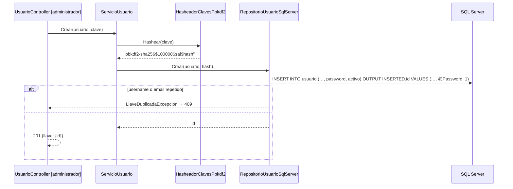

La clave en claro nunca llega al repositorio. Cambiar la clave (`ActualizarParcial` con `clave`) sigue el mismo camino: se hashea en el servicio.

## 12. `ServicioUsuario.Eliminar`

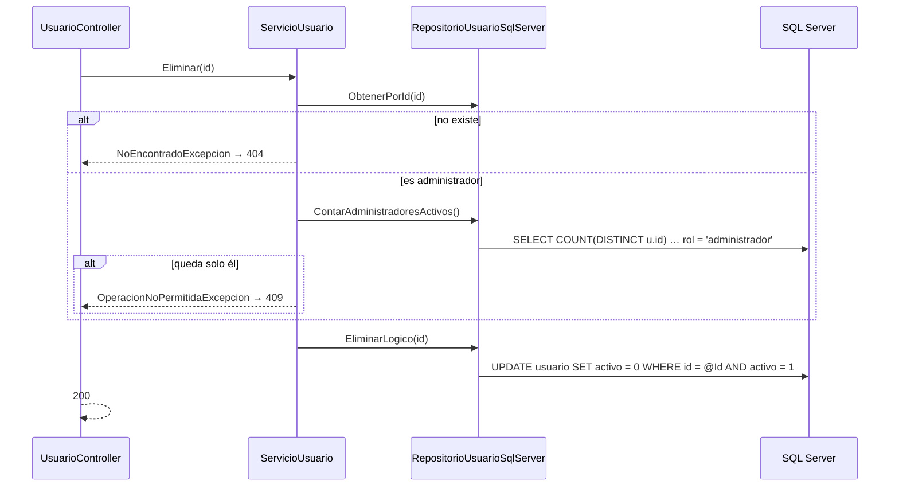

`ServicioRol.Eliminar` sigue la misma forma: 409 si es un rol del sistema o si tiene usuarios activos.

## 13. `ServicioRolUsuario.Asignar` y `Quitar`

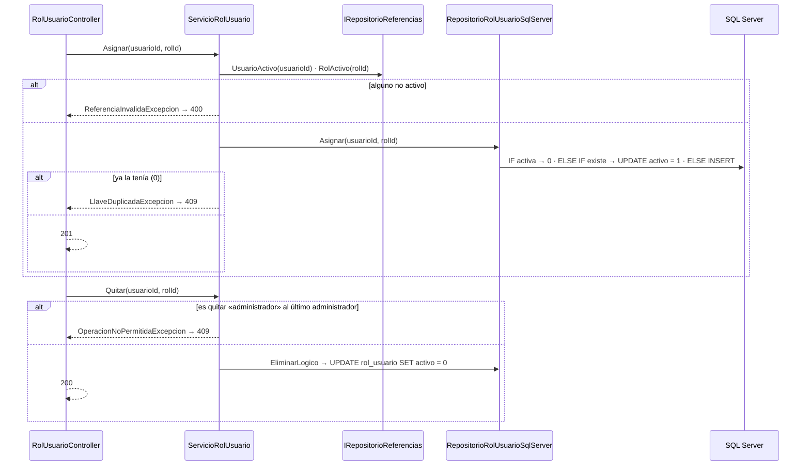

## 14. `AsegurarAdministradorInicial` — al arrancar la API

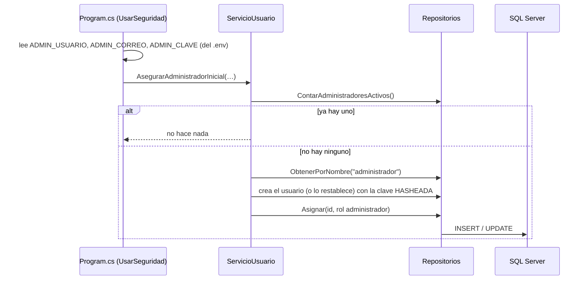

## 15. Ingresar en el front (`/ingresar`)

```mermaid
sequenceDiagram
    actor U as Usuario
    participant I as Ingresar.razor (estática)
    participant SS as ServicioSesion
    participant API as API /api/login
    participant CK as Cookie + AlmacenSesionesMemoria
    U->>I: usuario y contraseña (POST con token antifalsificación)
    I->>SS: IniciarSesion(usuario, clave)
    SS->>API: POST /api/login
    alt 401 / 403
        API-->>I: detalle
        I-->>U: aviso en rojo
    else 200
        API-->>SS: {token, expira, roles}
        I->>CK: SignInAsync(claims + "jwt", ExpiresUtc = expira)
        CK->>CK: guarda el ticket EN EL SERVIDOR; al navegador solo va una cookie HttpOnly
        I-->>U: redirige a ReturnUrl (solo direcciones locales)
    end
```

## 16. `ClienteApi.Enviar` — el token en cada petición y la sesión vencida

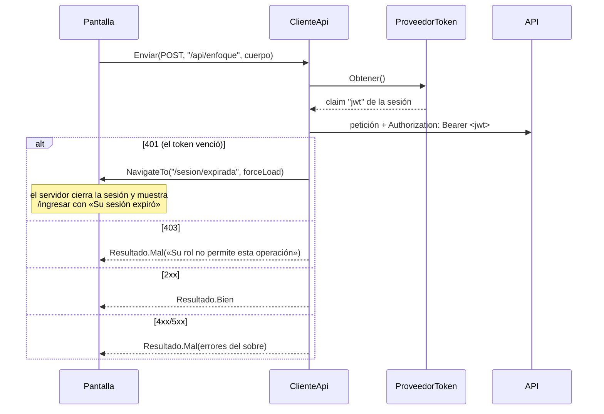

Lo usan los servicios del front de las 25 tablas; ninguna pantalla hace HTTP directamente.

## 17. Cerrar sesión (`/sesion/salir`)

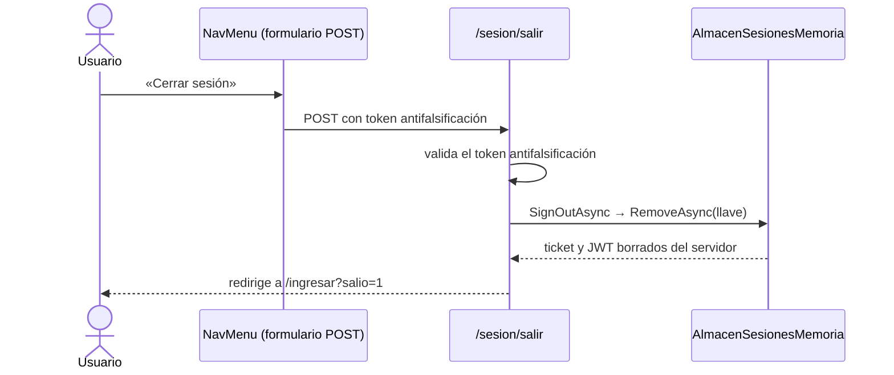
