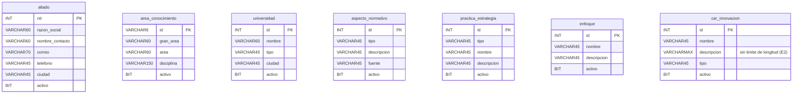

# Modelo de datos — Entrega 1: las siete tablas

> Complementa [v1_aliado/5_data_model.md](../v1_aliado/5_data_model.md) §1
> (la base viene completa, 25 tablas desde el inicio — Artículo 5) y §4
> (invariantes de quién escribe qué), que aplican sin cambios a las siete
> tablas. Aquí solo se documentan las columnas y las semillas específicas
> de cada una.

## 1. Las siete tablas

| Tabla | Llave | Columnas (además de `activo`) |
|---|---|---|
| `aliado` | `nit INT` | `razon_social VARCHAR(60)`, `nombre_contacto VARCHAR(60)`, `correo VARCHAR(70)`, `telefono VARCHAR(45)`, `ciudad VARCHAR(45)` |
| `area_conocimiento` | `id VARCHAR(6)` | `gran_area VARCHAR(60)`, `area VARCHAR(60)`, `disciplina VARCHAR(150)` |
| `universidad` | `id INT` | `nombre VARCHAR(60)`, `tipo VARCHAR(45)`, `ciudad VARCHAR(45)` |
| `aspecto_normativo` | `id INT` | `tipo VARCHAR(45)`, `descripcion VARCHAR(45)`, `fuente VARCHAR(45)` |
| `practica_estrategia` | `id INT` | `tipo VARCHAR(45)`, `nombre VARCHAR(45)`, `descripcion VARCHAR(45)` |
| `enfoque` | `id INT` | `nombre VARCHAR(45)`, `descripcion VARCHAR(45)` |
| `car_innovacion` | `id INT` | `nombre VARCHAR(45)`, `descripcion VARCHAR(MAX)`, `tipo VARCHAR(45)` |

Ninguna llave es `IDENTITY`: la asigna quien hace el `POST` (E4), igual
que el `nit` de `aliado`.

## 2. Las semillas: dos tablas llenas, cinco vacías

| Tabla | Filas al arrancar | Fuente |
|---|---|---|
| `area_conocimiento` | **218** | Catálogo del Excel de referencia del módulo |
| `universidad` | **6** | Las seccionales y extensiones de la universidad, cargadas de fábrica |
| `aliado` | 0 | A propósito (C7 de `v1_aliado`) |
| `aspecto_normativo` | 0 | El Excel no trae catálogo para esta tabla |
| `practica_estrategia` | 0 | Ídem |
| `enfoque` | 0 | Ídem |
| `car_innovacion` | 0 | Ídem |

Esto cambia lo que prueba el criterio 2 según la tabla (E3):

- **Las cinco vacías** (`aliado`, `aspecto_normativo`,
  `practica_estrategia`, `enfoque`, `car_innovacion`): el primer `GET`
  responde **204**, igual que en `v1_aliado`.
- **`area_conocimiento` y `universidad`**: el primer `GET` responde
  **200** con `total: 218` y `total: 6` respectivamente. El 204 de
  listado vacío no se puede ejercitar sobre estas dos tablas en el
  ambiente con datos de semilla.

## 3. Reglas de esta versión

Las mismas de [v1_aliado/5_data_model.md §5](../v1_aliado/5_data_model.md):
toda consulta parametrizada, todo listado con `WHERE activo = 1`, y esta
entrega no crea, altera ni borra objetos de la base — el esquema de las
25 tablas viene dado.
