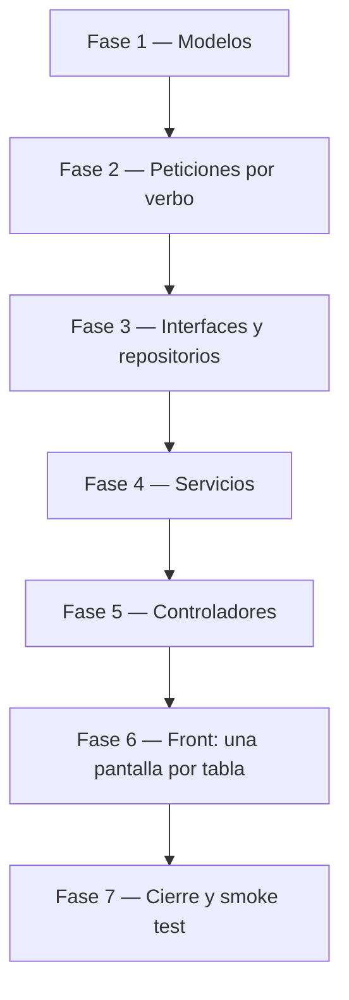

# Tareas — Entrega 1: las seis tablas restantes

> A diferencia de [v1_aliado/8_tasks.md](../v1_aliado/8_tasks.md), que
> guía la construcción del patrón desde cero, este documento registra la
> **verificación** de un código que ya existe: las capas de las seis
> tablas restantes se escribieron replicando el patrón de `aliado`
> archivo por archivo. Las casillas marcan lo ya construido; cada fase
> conserva su compuerta para poder volver a correrla en cualquier
> momento.

## Fase 1 — Modelos · una clase de dominio por tabla

- [x] `Modelos/AreaConocimiento.cs`, `Universidad.cs`,
      `AspectoNormativo.cs`, `PracticaEstrategia.cs`, `Enfoque.cs`,
      `CarInnovacion.cs` — sin la propiedad `Activo`, igual que `Aliado.cs`

**Verificar:** `dotnet build api_innovacion` compila.

## Fase 2 — Las tres peticiones por tabla · *Crear / Reemplazo / Actualizar*

- [x] `Peticiones/<Tabla>Crear.cs` — todos los campos `[Required]`, con el
      `[MaxLength]` que dicta el esquema de cada columna
- [x] `Peticiones/<Tabla>Reemplazo.cs` — los campos del cuerpo,
      obligatorios; la llave no aparece (va en la ruta)
- [x] `Peticiones/<Tabla>Actualizar.cs` — los mismos campos, todos
      opcionales (`string?`)

**Verificar:** el par `Reemplazo`/`Actualizar` de cada tabla reproduce la
lección del contrato — el mismo cuerpo da 422 en `PUT` y 200 en `PATCH`.
Confirmado por inspección de las 18 clases (6 tablas × 3 peticiones).

## Fase 3 — Interfaces y repositorios · *el SQL parametrizado*

- [x] `Repositorios/IRepositorio<Tabla>.cs` y
      `Repositorios/Repositorio<Tabla>SqlServer.cs` — Dapper, siempre
      parametrizado, `WHERE activo = 1` en todo listado y
      `UPDATE … SET activo = 0` en el borrado

**Verificar:** una lectura de las seis implementaciones confirma que
ninguna consulta concatena valores y que ningún listado olvida el
`activo = 1` (igual que la Fase 3 de `v1_aliado`).

## Fase 4 — Servicios · *reglas de negocio y excepciones*

- [x] `Servicios/IServicio<Tabla>.cs` y `Servicios/Servicio<Tabla>.cs` —
      lanzan `NoEncontradoExcepcion` cuando el repositorio no devuelve
      nada, igual que `ServicioAliado`

**Verificar:** `dotnet build api_innovacion` compila con las seis
interfaces registradas.

## Fase 5 — Controladores y ensamblado · *los 7 endpoints por tabla*

- [x] `Controllers/<Tabla>Controller.cs` — ruta `api/<tabla>`, los cinco
      verbos más el listado, con la misma traducción de excepciones a
      HTTP que `AliadoController`
- [x] `Program.cs` registra las seis interfaces adicionales junto a las
      de `aliado`; el endpoint de diagnóstico `GET /` sigue siendo uno
      solo

**Verificar:** `docker compose up -d --build` y, para cada tabla, el
smoke test de [6_contracts.md](6_contracts.md).

## Fase 6 — Front: una pantalla por tabla

- [x] `front_blazor/Components/Pages/<Tabla>.razor` y
      `front_blazor/Servicios/Servicio<Tabla>.cs` (llamadas HTTP, sin
      ningún paquete de acceso a datos) para las seis tablas
- [x] `NavMenu.razor` enlaza las siete pantallas, cada una con su propia
      dirección (Artículo 10.1 / criterio P2)

**Verificar:** los criterios de pantalla P1–P7 de
[2_spec.md §5](2_spec.md), uno por cada una de las siete pantallas.

## Fase 7 — Cierre

- [ ] Correr el smoke test completo de las siete tablas y pegar la salida
      real (los ejemplos de [6_contracts.md](6_contracts.md) son la
      referencia, no un sustituto de correrlos)
- [ ] Pasar y **firmar** [9_checklist.md](9_checklist.md)
- [ ] Actualizar `postman/coleccion_v1.postman_collection.json` con las
      seis tablas nuevas
- [ ] Commit y **tag `v1`** — una sola vez, para las siete tablas

**Verificar:** los criterios de aceptación de las siete tablas en verde,
con la salida real pegada. Sin eso no hay tag.
