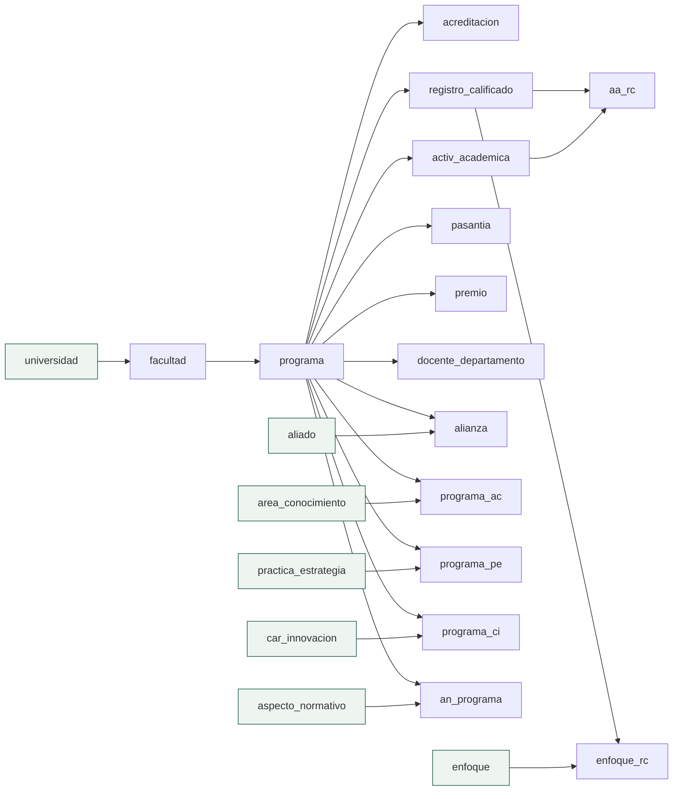

# Especificación — Entrega 2: las 15 tablas con clave foránea

> **Versión 2** ([mapa](../0_mapa_versiones.md)) · Crece SOBRE la v1 sin
> romperla. Ante conflicto con este documento, manda la
> [constitución](../../1_constitution.md) (1.1.0); para todo lo que no sea
> propio de la v2 —capas, contenedores, sobres, PUT contra PATCH— manda
> [v1_aliado](../v1_aliado/2_spec.md).

## 1. Propósito de la v2

Completar el CRUD de las **22 tablas** del módulo: a las 7 de la v1 se suman
las **15 que tienen clave foránea**. La v2 trae dos ideas nuevas, y solo dos:

1. **Una fila hija solo puede apuntar a un padre ACTIVO.** La FK del motor no
   alcanza: un padre retirado sigue existiendo en la tabla (borrado lógico),
   así que el motor acepta un hijo que apunte a él. La API lo comprueba antes.
2. **Un padre con hijos activos no se puede retirar.** Si se pudiera, sus hijos
   quedarían colgando de un registro que ya no aparece en ninguna lista:
   registros huérfanos.

Todo lo demás es el patrón de la v1 —controlador, servicio, repositorio,
peticiones por verbo, borrado lógico, prueba de capas— repetido quince veces.

**Guía de lectura:** cada flecha va del padre al hijo; las cajas verdes son las
siete tablas de la v1, que en la v2 pasan a ser padres. `programa` es el centro
del modelo: once tablas apuntan a él, y por eso es la tabla que más cuesta
retirar.

## 2. Alcance

**Incluye**

- El CRUD de las **15 tablas con FK**: listar, obtener por llave, crear,
  reemplazar (PUT), actualizar parcialmente (PATCH) y retirar (DELETE lógico).
- **Validación de claves foráneas** al crear, reemplazar y actualizar: el
  padre debe existir y estar activo → si no, **400**.
- **Protección contra huérfanos**: retirar un padre con hijos activos → **409**.
  Aplica también a las 7 tablas de la v1, que ahora tienen hijos.
- Llave primaria repetida en una tabla de la v2 → **409** (no 500).
- Front Blazor: una pantalla por tabla, con **listas desplegables cargadas
  desde la API** para cada clave foránea.
- Prueba de capas de los 15 servicios, sin base de datos, y prueba de humo de
  la API contra el sistema levantado.
- La regresión de la v1 completa.

**NO incluye** — no se anticipa (Artículo 1)

- JWT, sesiones, roles ni las tablas `usuario`/`rol`/`rol_usuario`: v3.
- Consultas multitabla y dashboard: v4.
- Reactivar un registro retirado.
- Retirar en cascada (retirar un programa y con él sus hijos): nadie lo pidió,
  y es la operación más peligrosa que podría tener el sistema.
- Sembrar `facultad` y `programa` con el Excel: ver C6 de la v1 y C1 aquí.

## 3. Requisitos funcionales

Cada tabla expone los endpoints de la v1 (RF1–RF6), con estas diferencias:

| RF | Qué cambia en la v2 |
|---|---|
| RF1 Listar | Igual: `{tabla, limite, total, datos}`, 204 si está vacía |
| RF2 Obtener | La ruta lleva **todas** las columnas de la llave: `/api/alianza/{aliado}/{departamento}` |
| RF3 Crear | **201** con `{estado, mensaje, llave}`. FK a un padre inexistente o retirado → 400. Llave repetida → 409 |
| RF4 Reemplazar | Igual que en la v1, más la validación de FK. Una columna **opcional** que no llegue queda en NULL |
| RF5 Actualizar | Igual que en la v1. Las reglas se validan sobre cómo **quedaría** el registro |
| RF6 Retirar | Si el registro tiene hijos activos → **409** con la lista de tablas y cuántos |

### RF8 — Las 15 tablas

| Bloque | Tabla | Ruta | Llave | Claves foráneas | Reglas propias |
|---|---|---|---|---|---|
| Académico | `facultad` | `/api/facultad/{id}` | `id` | `universidad` → universidad | `tipo` ∈ {Facultad, Departamento, Instituto} |
| Académico | `programa` | `/api/programa/{id}` | `id` | `facultad` → facultad | `fecha_cierre` opcional |
| Académico | `acreditacion` | `/api/acreditacion/{resolucion}` | `resolucion` | `programa` → programa | — |
| Académico | `registro_calificado` | `/api/registro_calificado/{codigo}` | `codigo` | `programa` → programa | `fecha_fin` ≥ `fecha_inicio` |
| Actividades | `activ_academica` | `/api/activ_academica/{id}` | `id` | `disenio` → programa (**opcional**) | créditos y horas ≥ 0 · `espejo` ∈ {0,1} |
| Actividades | `pasantia` | `/api/pasantia/{id}` | `id` | `programa` → programa | — |
| Actividades | `premio` | `/api/premio/{id}` | `id` | `programa` → programa | — |
| Actividades | `docente_departamento` | `/api/docente_departamento/{docente}/{departamento}` | compuesta | `departamento` → programa | `dedicacion` ∈ {Tiempo Completo, Medio Tiempo, Cátedra} · `fecha_salida` ≥ `fecha_ingreso` |
| Actividades | `alianza` | `/api/alianza/{aliado}/{departamento}` | compuesta | `aliado` → aliado · `departamento` → programa | `fecha_fin` ≥ `fecha_inicio` |
| Puentes | `programa_ac` | `/api/programa_ac/{programa}/{areaConocimiento}` | compuesta | → programa · → area_conocimiento | sin PUT/PATCH |
| Puentes | `programa_pe` | `/api/programa_pe/{programa}/{practicaEstrategia}` | compuesta | → programa · → practica_estrategia | sin PUT/PATCH |
| Puentes | `programa_ci` | `/api/programa_ci/{programa}/{carInnovacion}` | compuesta | → programa · → car_innovacion | sin PUT/PATCH |
| Puentes | `an_programa` | `/api/an_programa/{aspectoNormativo}/{programa}` | compuesta | → aspecto_normativo · → programa | sin PUT/PATCH |
| Puentes | `enfoque_rc` | `/api/enfoque_rc/{enfoque}/{registroCalificado}` | compuesta | → enfoque · → registro_calificado | sin PUT/PATCH |
| Puentes | `aa_rc` | `/api/aa_rc/{activAcademicasIdcurso}/{registroCalificadoCodigo}` | compuesta | → activ_academica · → registro_calificado | — |

El detalle campo por campo está en [5_data_model.md](5_data_model.md) y los
contratos exactos en [6_contracts.md](6_contracts.md).

### RF9 — Retirar un padre de la v1

Las siete tablas de la v1 ahora tienen hijos. Su `DELETE` responde **409** si
el registro tiene hijos activos (`universidad` → facultades; `aliado` →
alianzas; `area_conocimiento`, `practica_estrategia`, `car_innovacion`,
`aspecto_normativo` y `enfoque` → sus tablas puente). Es una regla nueva sobre
una versión cerrada, y se justifica: la v1 no podía tener ese caso porque sus
hijos no existían. Todos sus demás contratos se mantienen.

### RF10 — Pantallas

Una pantalla por tabla, con dirección propia (`/facultades`, `/programas`…), con
la misma forma que las de la v1: listado, «Agregar», «Editar» con los dos
botones de guardar, «Retirar» con confirmación, y avisos en el idioma del
usuario. Cada clave foránea es una **lista desplegable** con los registros
activos del padre, pedidos a la API (nunca a la base). Las tablas puente sin
más columnas que su llave no tienen «Editar».

## 4. Requisitos no funcionales

- Los de la v1, sin excepción: un solo comando, tres capas con interfaces, SQL
  a mano parametrizado, todo en español, Swagger.
- **Cero secretos versionados** (Artículo 7, enmienda 1.1.0): `.env` +
  `.env.example`.
- **Migraciones idempotentes**: un equipo que ya tiene la base de la v1 recibe
  la v2 sin borrar su volumen.
- Tres estudiantes en paralelo **sin editar los mismos archivos** en la misma
  ronda (enmienda 1.1.0 del Artículo 3 y [8_tasks.md](8_tasks.md)).

## 5. Criterios de aceptación

1. **Un solo comando** levanta las tres piezas con la v2: `GET /` responde
   `"version":"v2"` y Swagger muestra los **22** recursos con su nombre.
2. **La cadena completa se puede construir por la API**: universidad 1 →
   facultad → programa → acreditación, registro calificado, actividad,
   pasantía, premio, vinculación docente, alianza y las seis relaciones.
   Cada `POST` responde **201**.
3. **Una FK hacia un padre inexistente o retirado responde 400** y no crea
   nada (comprobado con un `GET` posterior → 404).
4. **Retirar un padre con hijos activos responde 409** con la lista de tablas
   dependientes; retirados los hijos, el mismo `DELETE` responde 200.
5. **Llave repetida en una tabla de la v2 responde 409.**
6. **PUT contra PATCH**: el mismo cuerpo incompleto responde 422 por PUT y 200
   por PATCH, en una tabla de la v2.
7. **Reglas de negocio**: `fecha_fin` anterior a `fecha_inicio`, un `tipo` de
   facultad fuera de la lista o `espejo = 5` responden 400.
8. **Borrado lógico**: después del DELETE la fila sigue en la base con
   `activo = 0` y no aparece en el listado.
9. **Prueba de capas**: los 15 servicios nuevos pasan sus comprobaciones **sin
   SQL Server** (`dotnet run` en `api_innovacion/pruebas`).
10. **Pantallas**: las 15 pantallas responden por su dirección y sus listas
    desplegables traen los registros del padre que dio la API.
11. **Regresión**: los criterios de la v1 siguen pasando.

## 6. Clarificaciones

| # | La pregunta | La respuesta, con su razón | Dónde quedó |
|---|---|---|---|
| C1 | `facultad` y `programa` siguen sin datos (C6 de la v1). ¿Se siembran ahora? | **No.** Sus columnas obligatorias no están en el Excel y rellenarlas sería inventar datos. Las pantallas permiten crearlos, y la prueba de humo construye su propia cadena por la API | §2 · `7_quickstart.md` |
| C2 | La FK del motor ya rechaza un padre inexistente. ¿Para qué validar en la API? | Porque **no** rechaza un padre **retirado**: la fila sigue ahí con `activo = 0`. Y porque el error del motor (547) no dice qué campo falló; la API sí | D-v2-5 |
| C3 | ¿Con qué código responde una FK inválida: 400, 404 o 422? | **400.** El cuerpo tiene la forma correcta (422 no); el recurso pedido por la ruta sí existe (404 no); lo que se rompe es una regla de negocio | Artículo 10 |
| C4 | Retirar un padre con hijos activos: ¿se impide o se retira en cascada? | **Se impide con 409.** La cascada borraría de las listas, de un clic, datos que nadie pidió borrar | D-v2-6 |
| C5 | Las tablas puente sin columnas propias, ¿tienen PUT y PATCH? | **No.** Su única información es la llave, y la llave no se cambia: cambiarla es crear otra relación. Se retira la vieja y se crea la nueva | RF8 |
| C6 | `docente_departamento.docente` y `alianza.docente` no tienen FK en el esquema: la tabla docente es de otro módulo | **No se validan contra nada.** Se guarda el documento del docente tal como llega; validar contra una tabla que este módulo no tiene sería inventar una regla | 5_data_model §3 |
| C7 | ¿La v1 cambia su 500 por 409 en llave duplicada? | **No.** La v1 está cerrada y su C11 lo decidió así. La v2 usa 409 desde el principio | Artículo 10 |
| C8 | Un PATCH que solo trae `fecha_fin`, ¿cómo valida que no sea anterior a la de inicio? | Leyendo primero el registro y validando cómo **quedaría** con el cambio. De paso, eso da el 404 antes que cualquier otra cosa | D-v2-7 |
| C9 | ¿Cómo se vacía un campo opcional (`fecha_cierre`)? | Con **PUT** sin ese campo: queda en NULL. En PATCH, `null` significa «no lo toque», así que no sirve para vaciar | 6_contracts §0 |

No queda ningún `[NECESITA ACLARACIÓN]` en este documento.

## 7. Definición de TERMINADA

1. Los **11 criterios** pasan con la prueba de humo de
   [7_quickstart.md](7_quickstart.md) corrida por una persona.
2. [9_checklist.md](9_checklist.md) en verde y firmado.
3. Las ramas de los tres estudiantes integradas en `main` por el encargado,
   en el orden de [8_tasks.md](8_tasks.md), y **tag `v2`** sobre `main`.
