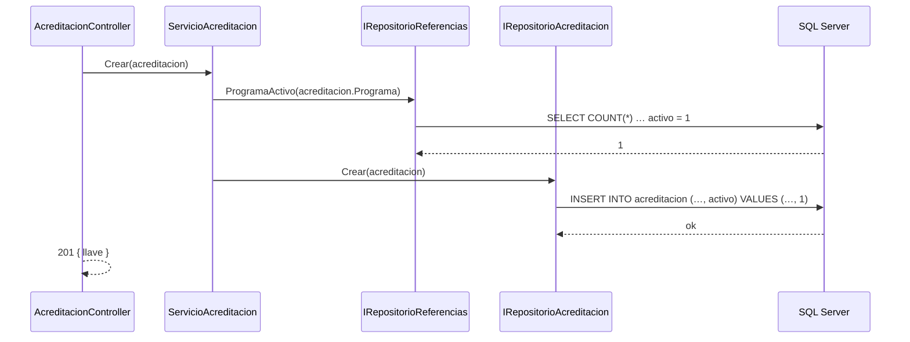
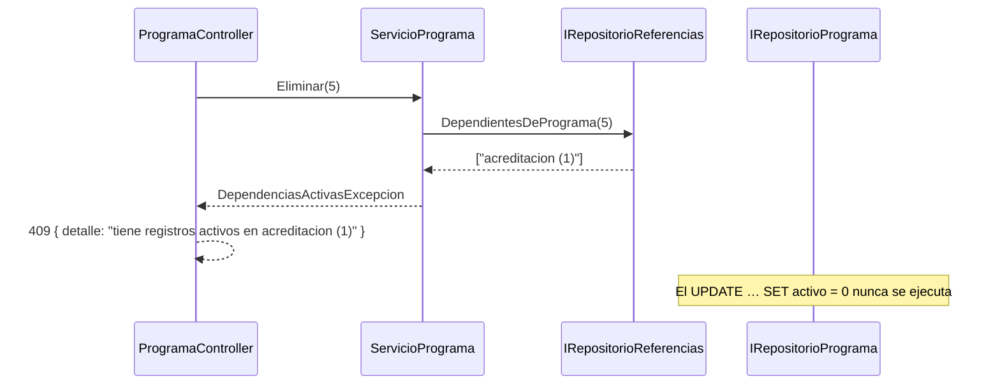

# Plan técnico — Versión 2

> CÓMO se construye lo que pide la [spec](2_spec.md). Lo que no se dice aquí
> es igual que en [v1_aliado/3_plan.md](../v1_aliado/3_plan.md).

## 1. Stack

Sin cambios: C# / ASP.NET Core (.NET 10), Dapper sobre
`Microsoft.Data.SqlClient`, SQL Server 2022, Blazor Server, Docker Compose.
**Ningún paquete nuevo.**

## 2. Qué se agrega, por capa

| Capa | Archivos nuevos por tabla | Compartido (ronda 0) |
|---|---|---|
| Modelo | `Modelos/<Tabla>.cs` (entidad + `<Tabla>Cambios` para el PATCH) | — |
| Peticiones | `<Tabla>Crear`, `<Tabla>Reemplazo`, `<Tabla>Actualizar` (las puentes puras, solo `Crear`) | — |
| Repositorio | `IRepositorio<Tabla>` + `Repositorio<Tabla>SqlServer` | `IRepositorioReferencias` + `RepositorioReferenciasSqlServer` |
| Servicio | `IServicio<Tabla>` + `Servicio<Tabla>` | — |
| Controlador | `<Tabla>Controller` | — |
| Excepciones | — | `ReferenciaInvalidaExcepcion` (400) · `DependenciasActivasExcepcion` (409) · `LlaveDuplicadaExcepcion` (409) |
| Ensamblador | — | `Ensamblador/EnsambladorV1`, `…Academico`, `…Actividades`, `…Puentes` |
| Front | `Servicios/Servicio<Tabla>.cs` + `Components/Pages/<Pantalla>.razor` | `ClienteApi`, `Resultado`, `Ensamblador/` del front, menú agrupado |
| Pruebas | — | `pruebas/Verificador`, `RepositorioReferenciasFalso`, un `Pruebas<Bloque>.cs` por bloque, `pruebas_humo/comun.py` |

## 3. El viaje de una petición con clave foránea

**Guía de lectura:** el servicio es el único que habla con dos repositorios;
el controlador sigue sin saber que existe la integridad referencial —solo
traduce la excepción—.

## 4. Decisiones aterrizadas

- **Un PATCH valida sobre el registro resultante** (D-v2-7): el servicio lee el
  actual, le aplica los cambios en memoria, valida, y le pasa al repositorio
  solo lo que llegó.
- **El repositorio compone el `SET` del PATCH** con nombres de columna de una
  lista cerrada escrita en el código; los valores siempre como `@parámetro`
  (igual que la v1).
- **Llave compuesta en la ruta**: un segmento tipado por columna (D-v2-8).
- **Las puentes puras no tienen PUT ni PATCH** (2_spec.md, C5).
- **Front**: cada pantalla con FK carga, al iniciar, la lista activa de cada
  padre por SU servicio (`ServicioPrograma.Listar()`, no un listado genérico)
  y la muestra como `<select>` con «llave — nombre».
- **Front, PATCH**: «Guardar solo lo que cambié» compara contra la copia que se
  cargó al abrir la edición (D-v2-10).

## 5. Docker

- `docker-compose.yml` sin secretos: lee `MSSQL_SA_PASSWORD` del `.env`
  (D-v2-2). Arranque: `cp .env.example .env` la primera vez, luego
  `docker compose up -d --build`.
- `db/init.sh` crea la base si no existe y **siempre** corre
  `db/migraciones/*.sql` (idempotentes). La v2 no trae migraciones: el esquema
  ya estaba completo.
- `.gitattributes` fuerza fin de línea LF en `*.sh` y `*.sql`: con CRLF el
  `init.sh` falla dentro del contenedor Linux.

## 6. Chequeo de constitución

| Artículo | ¿Cumple? | Cómo |
|---|---|---|
| 1 — por versiones | Sí | Nada de JWT ni roles en la v2 |
| 1.1 — cada versión con su front | Sí | 15 pantallas en la misma versión |
| 2 — stack, SQL a mano | Sí | Ningún paquete nuevo; SQL escrito por tabla |
| 3 — capas y ensamblador | Sí, con la **enmienda 1.1.0** | Ensamblador repartido en `Ensamblador/` |
| 4 — un solo comando | Sí | Más copiar `.env` la primera vez (enmienda 1.1.0 del Artículo 7) |
| 5 — la base viene dada | Sí | Sin cambios de esquema |
| 6 — borrado lógico | Sí | `UPDATE … SET activo = 0` en las 15 |
| 7 — secretos | Sí, con la **enmienda 1.1.0** | `.env` + `.env.example` |
| 8 — explícito | Sí | Un archivo por responsabilidad y por tabla |
| 9 — contratos exactos | Sí | [6_contracts.md](6_contracts.md) |
| 10 / 10.1 — rutas y servicios por recurso | Sí, con la **enmienda 1.1.0** | 409 y 201 agregados; `ClienteApi` es transporte |
| 12 — identidad visual | Sí | Las pantallas nuevas usan las clases de `app.css`, sin colores nuevos |
