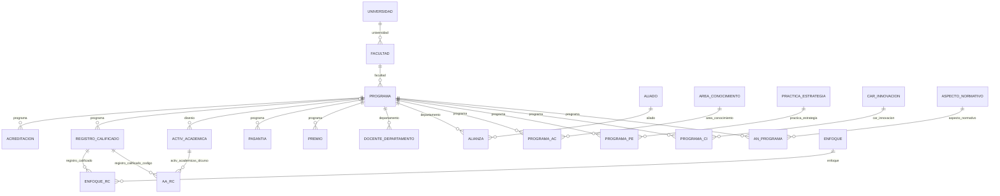

# Modelo de datos — Versión 2

> La base ya existe completa desde la v1 (Artículo 5): las 15 tablas de esta
> versión y su columna `activo` vienen en `db/innovacion_curricular.sql`. La
> v2 **no cambia el esquema**: lo que crece es lo que el código puede nombrar.
> Este documento se generó a partir del mismo inventario de columnas que el
> código, para que no puedan contradecirse.

## 1. Las relaciones

**Guía de lectura:** `||--o{` es «un padre, muchos hijos, y el hijo siempre
tiene padre»; `|o--o{` (solo `activ_academica.disenio`) es una FK **opcional**:
la actividad puede existir sin programa. `docente` en `docente_departamento` y
en `alianza` no aparece: no tiene FK en este módulo (2_spec.md, C6).

## 2. Las 15 tablas, columna por columna

### Bloque Academico — responsable: Sebastián Calvo

#### `facultad`

Las facultades, departamentos e institutos de cada sede de la universidad. Tiene hijos: se protege con `DependientesDeFacultad`.

| Columna | Tipo | Obligatoria | Llave | Referencia | JSON |
|---|---|---|---|---|---|
| `id` | `INT` | sí | PK |  | `id` |
| `nombre` | `VARCHAR(60)` | sí |  |  | `nombre` |
| `tipo` | `VARCHAR(45)` | sí |  |  | `tipo` |
| `fecha_fun` | `DATE` | sí |  |  | `fechaFun` |
| `universidad` | `INT` | sí |  | `universidad` | `universidad` |

#### `programa`

Los programas de pregrado y posgrado que ofrece cada facultad. Tiene hijos: se protege con `DependientesDePrograma`.

| Columna | Tipo | Obligatoria | Llave | Referencia | JSON |
|---|---|---|---|---|---|
| `id` | `INT` | sí | PK |  | `id` |
| `nombre` | `VARCHAR(150)` | sí |  |  | `nombre` |
| `tipo` | `VARCHAR(45)` | sí |  |  | `tipo` |
| `nivel` | `VARCHAR(45)` | sí |  |  | `nivel` |
| `fecha_creacion` | `VARCHAR(45)` | sí |  |  | `fechaCreacion` |
| `fecha_cierre` | `VARCHAR(45)` | **no** (NULL) |  |  | `fechaCierre` |
| `numero_cohortes` | `VARCHAR(45)` | sí |  |  | `numeroCohortes` |
| `cant_graduados` | `VARCHAR(45)` | sí |  |  | `cantGraduados` |
| `fecha_actualizacion` | `VARCHAR(45)` | sí |  |  | `fechaActualizacion` |
| `ciudad` | `VARCHAR(45)` | sí |  |  | `ciudad` |
| `facultad` | `INT` | sí |  | `facultad` | `facultad` |

#### `acreditacion`

Las acreditaciones de alta calidad otorgadas a los programas, por número de resolución. No tiene hijos.

| Columna | Tipo | Obligatoria | Llave | Referencia | JSON |
|---|---|---|---|---|---|
| `resolucion` | `INT` | sí | PK |  | `resolucion` |
| `tipo` | `VARCHAR(45)` | sí |  |  | `tipo` |
| `calificacion` | `VARCHAR(45)` | sí |  |  | `calificacion` |
| `fecha_inicio` | `VARCHAR(45)` | sí |  |  | `fechaInicio` |
| `fecha_fin` | `VARCHAR(45)` | sí |  |  | `fechaFin` |
| `programa` | `INT` | sí |  | `programa` | `programa` |

#### `registro_calificado`

El documento legal que autoriza el funcionamiento de cada programa. Tiene hijos: se protege con `DependientesDeRegistroCalificado`.

| Columna | Tipo | Obligatoria | Llave | Referencia | JSON |
|---|---|---|---|---|---|
| `codigo` | `INT` | sí | PK |  | `codigo` |
| `cant_creditos` | `VARCHAR(45)` | sí |  |  | `cantCreditos` |
| `hora_acom` | `VARCHAR(45)` | sí |  |  | `horaAcom` |
| `hora_ind` | `VARCHAR(45)` | sí |  |  | `horaInd` |
| `metodologia` | `VARCHAR(45)` | sí |  |  | `metodologia` |
| `fecha_inicio` | `DATE` | sí |  |  | `fechaInicio` |
| `fecha_fin` | `DATE` | sí |  |  | `fechaFin` |
| `duracion_anios` | `VARCHAR(45)` | sí |  |  | `duracionAnios` |
| `duracion_semestres` | `VARCHAR(45)` | sí |  |  | `duracionSemestres` |
| `tipo_titulacion` | `VARCHAR(45)` | sí |  |  | `tipoTitulacion` |
| `programa` | `INT` | sí |  | `programa` | `programa` |

### Bloque Actividades — responsable: David Epia

#### `activ_academica`

Los cursos y asignaturas: créditos, horas, idioma y si son espejo con otra institución. Tiene hijos: se protege con `DependientesDeActivAcademica`.

| Columna | Tipo | Obligatoria | Llave | Referencia | JSON |
|---|---|---|---|---|---|
| `id` | `INT` | sí | PK |  | `id` |
| `nombre` | `VARCHAR(45)` | sí |  |  | `nombre` |
| `num_creditos` | `INT` | sí |  |  | `numCreditos` |
| `tipo` | `VARCHAR(20)` | sí |  |  | `tipo` |
| `area_formacion` | `VARCHAR(45)` | sí |  |  | `areaFormacion` |
| `h_acom` | `INT` | sí |  |  | `hAcom` |
| `h_indep` | `INT` | sí |  |  | `hIndep` |
| `idioma` | `VARCHAR(45)` | sí |  |  | `idioma` |
| `espejo` | `TINYINT` | sí |  |  | `espejo` |
| `entidad_espejo` | `VARCHAR(45)` | sí |  |  | `entidadEspejo` |
| `pais_espejo` | `VARCHAR(45)` | sí |  |  | `paisEspejo` |
| `disenio` | `INT` | **no** (NULL) |  | `programa` | `disenio` |

#### `pasantia`

Las pasantías disponibles para los estudiantes de cada programa. No tiene hijos.

| Columna | Tipo | Obligatoria | Llave | Referencia | JSON |
|---|---|---|---|---|---|
| `id` | `INT` | sí | PK |  | `id` |
| `nombre` | `VARCHAR(45)` | sí |  |  | `nombre` |
| `pais` | `VARCHAR(45)` | sí |  |  | `pais` |
| `empresa` | `VARCHAR(45)` | sí |  |  | `empresa` |
| `descripcion` | `VARCHAR(45)` | sí |  |  | `descripcion` |
| `programa` | `INT` | sí |  | `programa` | `programa` |

#### `premio`

Los premios y reconocimientos recibidos por los programas, con la entidad que los otorga. No tiene hijos.

| Columna | Tipo | Obligatoria | Llave | Referencia | JSON |
|---|---|---|---|---|---|
| `id` | `INT` | sí | PK |  | `id` |
| `nombre` | `VARCHAR(45)` | sí |  |  | `nombre` |
| `descripcion` | `VARCHAR(45)` | sí |  |  | `descripcion` |
| `fecha` | `DATE` | sí |  |  | `fecha` |
| `entidad_otorgante` | `VARCHAR(45)` | sí |  |  | `entidadOtorgante` |
| `pais` | `VARCHAR(45)` | sí |  |  | `pais` |
| `programa` | `INT` | sí |  | `programa` | `programa` |

#### `docente_departamento`

La vinculación de cada docente a un programa (departamento): dedicación, modalidad y fechas. No tiene hijos.

| Columna | Tipo | Obligatoria | Llave | Referencia | JSON |
|---|---|---|---|---|---|
| `docente` | `INT` | sí | PK |  | `docente` |
| `departamento` | `INT` | sí | PK | `programa` | `departamento` |
| `dedicacion` | `VARCHAR(15)` | sí |  |  | `dedicacion` |
| `modalidad` | `VARCHAR(45)` | sí |  |  | `modalidad` |
| `fecha_ingreso` | `DATE` | sí |  |  | `fechaIngreso` |
| `fecha_salida` | `DATE` | **no** (NULL) |  |  | `fechaSalida` |

#### `alianza`

Las alianzas formales entre un aliado externo y un programa académico. No tiene hijos.

| Columna | Tipo | Obligatoria | Llave | Referencia | JSON |
|---|---|---|---|---|---|
| `aliado` | `INT` | sí | PK | `aliado` | `aliado` |
| `departamento` | `INT` | sí | PK | `programa` | `departamento` |
| `fecha_inicio` | `DATE` | sí |  |  | `fechaInicio` |
| `fecha_fin` | `DATE` | **no** (NULL) |  |  | `fechaFin` |
| `docente` | `INT` | **no** (NULL) |  |  | `docente` |

### Bloque Puentes — responsable: Sebastián Brunal

#### `programa_ac`

Qué áreas de conocimiento cubre cada programa. No tiene hijos.

| Columna | Tipo | Obligatoria | Llave | Referencia | JSON |
|---|---|---|---|---|---|
| `programa` | `INT` | sí | PK | `programa` | `programa` |
| `area_conocimiento` | `VARCHAR(6)` | sí | PK | `area_conocimiento` | `areaConocimiento` |

#### `programa_pe`

Qué prácticas y estrategias pedagógicas aplica cada programa. No tiene hijos.

| Columna | Tipo | Obligatoria | Llave | Referencia | JSON |
|---|---|---|---|---|---|
| `programa` | `INT` | sí | PK | `programa` | `programa` |
| `practica_estrategia` | `INT` | sí | PK | `practica_estrategia` | `practicaEstrategia` |

#### `programa_ci`

Qué características de innovación curricular tiene cada programa. No tiene hijos.

| Columna | Tipo | Obligatoria | Llave | Referencia | JSON |
|---|---|---|---|---|---|
| `programa` | `INT` | sí | PK | `programa` | `programa` |
| `car_innovacion` | `INT` | sí | PK | `car_innovacion` | `carInnovacion` |

#### `an_programa`

Qué aspectos normativos regulan cada programa. No tiene hijos.

| Columna | Tipo | Obligatoria | Llave | Referencia | JSON |
|---|---|---|---|---|---|
| `aspecto_normativo` | `INT` | sí | PK | `aspecto_normativo` | `aspectoNormativo` |
| `programa` | `INT` | sí | PK | `programa` | `programa` |

#### `enfoque_rc`

Qué enfoques pedagógicos declara cada registro calificado. No tiene hijos.

| Columna | Tipo | Obligatoria | Llave | Referencia | JSON |
|---|---|---|---|---|---|
| `enfoque` | `INT` | sí | PK | `enfoque` | `enfoque` |
| `registro_calificado` | `INT` | sí | PK | `registro_calificado` | `registroCalificado` |

#### `aa_rc`

Qué actividades académicas incluye cada registro calificado, con su componente y semestre. No tiene hijos.

| Columna | Tipo | Obligatoria | Llave | Referencia | JSON |
|---|---|---|---|---|---|
| `activ_academicas_idcurso` | `INT` | sí | PK | `activ_academica` | `activAcademicasIdcurso` |
| `registro_calificado_codigo` | `INT` | sí | PK | `registro_calificado` | `registroCalificadoCodigo` |
| `componente` | `VARCHAR(45)` | sí |  |  | `componente` |
| `semestre` | `VARCHAR(45)` | sí |  |  | `semestre` |

## 3. Invariantes de la v2

| Invariante | Quién la defiende |
|---|---|
| Toda FK obligatoria apunta a un padre **activo** al crear o modificar | El servicio, con `IRepositorioReferencias` (D-v2-5). La FK del motor queda de última defensa |
| Un padre con hijos activos no se retira | El servicio, con `DependientesDeX` → 409 (D-v2-6) |
| La llave primaria no se repite, ni siquiera con un registro retirado | El motor (PK) → el repositorio la traduce a `LlaveDuplicadaExcepcion` → 409 |
| `fecha_fin` ≥ `fecha_inicio` donde existen las dos | El servicio, sobre el registro resultante (D-v2-7) |
| `facultad.tipo` ∈ {Facultad, Departamento, Instituto} · `docente_departamento.dedicacion` ∈ {Tiempo Completo, Medio Tiempo, Cátedra} · `activ_academica.espejo` ∈ {0, 1} | El servicio |
| `activo` nunca viaja en el JSON | El modelo no tiene esa propiedad |

## 4. Datos iniciales

La v2 **no siembra** datos (2_spec.md, C1). Los catálogos de la v1 siguen
cargados (6 universidades, 218 áreas de conocimiento); todo lo demás se crea por
la API o por las pantallas.

## 5. Migraciones

`db/init.sh` ejecuta en cada arranque los scripts de `db/migraciones/`, todos
idempotentes. La v2 no necesita ninguno: su esquema ya estaba.
