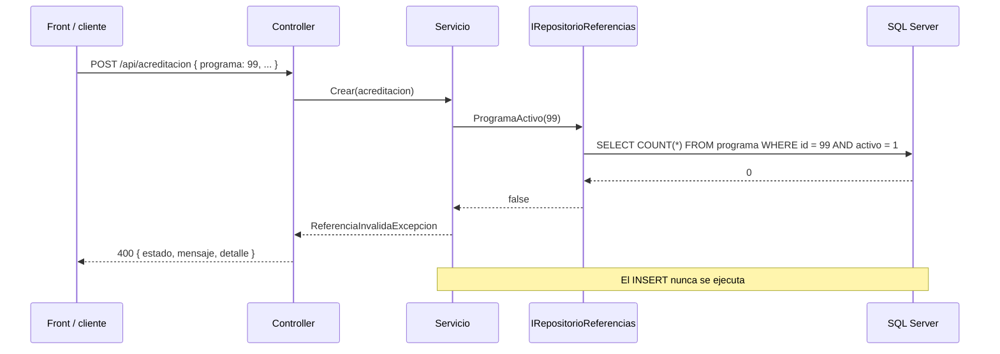

# Contratos HTTP — Versión 2

> Los contratos de la v1 siguen vigentes sin cambios, salvo uno: el `DELETE` de
> las siete tablas de la v1 puede responder **409** si el registro tiene hijos
> activos (2_spec.md, RF9). Este documento se generó del mismo inventario de
> columnas que el código.

## 0. Convenciones de la v2

| Cosa | Convención |
|---|---|
| JSON | camelCase, igual que la v1: `fechaFun`, `registroCalificadoCodigo` |
| Llave compuesta | Un segmento de ruta por columna, en el orden de la PK (D-v2-8) |
| Fechas (`DATE`) | `"AAAA-MM-DD"` al enviar; la API devuelve `"AAAA-MM-DDT00:00:00"` |
| Campo opcional | En `POST` y `PUT` puede omitirse o ir en `null` → queda NULL. En `PATCH`, `null` = «no lo toque» (2_spec.md, C9) |
| Crear | **201** `{ "estado": 201, "mensaje": "Registro creado exitosamente.", "llave": {…} }` |
| FK inválida | **400** `{ "estado": 400, "mensaje": "Parámetros inválidos.", "detalle": "El programa 99 no existe o está retirado: el campo programa debe apuntar a un registro activo." }` |
| Hijos activos | **409** `{ "estado": 409, "mensaje": "Tiene registros que dependen de él.", "detalle": "No se puede retirar el programa 5: tiene registros activos en acreditacion (1), premio (2). Retírelos primero." }` |
| Llave repetida | **409** `{ "estado": 409, "mensaje": "La llave ya existe.", "detalle": "…" }` |

## 1. El error, dibujado



## 2. Los 15 recursos

### `facultad` — bloque Academico

| Verbo | Ruta | Respuestas |
|---|---|---|
| `GET` | `/api/facultad?limite=N` | 200 `{tabla, limite, total, datos}` · 204 vacía · 400 `limite <= 0` |
| `GET` | `/api/facultad/{id}` | 200 la ficha · 404 |
| `POST` | `/api/facultad` | **201** `{estado, mensaje, llave: { "id": 7001 }}` · 422 cuerpo inválido · 400 FK o regla · 409 llave repetida |
| `PUT` | `/api/facultad/{id}` | 200 `{estado, mensaje, filasAfectadas}` · 422 falta un obligatorio · 400 FK o regla · 404 |
| `PATCH` | `/api/facultad/{id}` | 200 `{…, filasAfectadas}` · 400 cuerpo vacío, FK o regla · 404 |
| `DELETE` | `/api/facultad/{id}` | 200 `{…, filasAfectadas}` · 404 no existe o ya retirado · **409** tiene hijos activos |

Obligatorios en `POST`: `id`, `nombre`, `tipo`, `fechaFun`, `universidad` (en `PUT`, los mismos sin la llave, que va en la ruta). Opcionales: —.

```json
POST /api/facultad
{
  "id": 7001,
  "nombre": "Nombre de ejemplo",
  "tipo": "Facultad",
  "fechaFun": "2024-02-01",
  "universidad": 1
}
```

### `programa` — bloque Academico

| Verbo | Ruta | Respuestas |
|---|---|---|
| `GET` | `/api/programa?limite=N` | 200 `{tabla, limite, total, datos}` · 204 vacía · 400 `limite <= 0` |
| `GET` | `/api/programa/{id}` | 200 la ficha · 404 |
| `POST` | `/api/programa` | **201** `{estado, mensaje, llave: { "id": 7001 }}` · 422 cuerpo inválido · 400 FK o regla · 409 llave repetida |
| `PUT` | `/api/programa/{id}` | 200 `{estado, mensaje, filasAfectadas}` · 422 falta un obligatorio · 400 FK o regla · 404 |
| `PATCH` | `/api/programa/{id}` | 200 `{…, filasAfectadas}` · 400 cuerpo vacío, FK o regla · 404 |
| `DELETE` | `/api/programa/{id}` | 200 `{…, filasAfectadas}` · 404 no existe o ya retirado · **409** tiene hijos activos |

Obligatorios en `POST`: `id`, `nombre`, `tipo`, `nivel`, `fechaCreacion`, `numeroCohortes`, `cantGraduados`, `fechaActualizacion`, `ciudad`, `facultad` (en `PUT`, los mismos sin la llave, que va en la ruta). Opcionales: `fechaCierre`.

```json
POST /api/programa
{
  "id": 7001,
  "nombre": "Nombre de ejemplo",
  "tipo": "Facultad",
  "nivel": "Nivel de ejemplo",
  "fechaCreacion": "Fecha de creación de ejemplo",
  "fechaCierre": "Fecha de cierre de ejemplo",
  "numeroCohortes": "Número de cohortes de ejemplo",
  "cantGraduados": "Cantidad de graduados de ejemplo",
  "fechaActualizacion": "Fecha de actualización de ejemplo",
  "ciudad": "Ciudad de ejemplo",
  "facultad": 901
}
```

### `acreditacion` — bloque Academico

| Verbo | Ruta | Respuestas |
|---|---|---|
| `GET` | `/api/acreditacion?limite=N` | 200 `{tabla, limite, total, datos}` · 204 vacía · 400 `limite <= 0` |
| `GET` | `/api/acreditacion/{resolucion}` | 200 la ficha · 404 |
| `POST` | `/api/acreditacion` | **201** `{estado, mensaje, llave: { "resolucion": 7001 }}` · 422 cuerpo inválido · 400 FK o regla · 409 llave repetida |
| `PUT` | `/api/acreditacion/{resolucion}` | 200 `{estado, mensaje, filasAfectadas}` · 422 falta un obligatorio · 400 FK o regla · 404 |
| `PATCH` | `/api/acreditacion/{resolucion}` | 200 `{…, filasAfectadas}` · 400 cuerpo vacío, FK o regla · 404 |
| `DELETE` | `/api/acreditacion/{resolucion}` | 200 `{…, filasAfectadas}` · 404 no existe o ya retirado |

Obligatorios en `POST`: `resolucion`, `tipo`, `calificacion`, `fechaInicio`, `fechaFin`, `programa` (en `PUT`, los mismos sin la llave, que va en la ruta). Opcionales: —.

```json
POST /api/acreditacion
{
  "resolucion": 7001,
  "tipo": "Facultad",
  "calificacion": "Calificación de ejemplo",
  "fechaInicio": "Fecha de inicio de ejemplo",
  "fechaFin": "Fecha de fin de ejemplo",
  "programa": 901
}
```

### `registro_calificado` — bloque Academico

| Verbo | Ruta | Respuestas |
|---|---|---|
| `GET` | `/api/registro_calificado?limite=N` | 200 `{tabla, limite, total, datos}` · 204 vacía · 400 `limite <= 0` |
| `GET` | `/api/registro_calificado/{codigo}` | 200 la ficha · 404 |
| `POST` | `/api/registro_calificado` | **201** `{estado, mensaje, llave: { "codigo": 7001 }}` · 422 cuerpo inválido · 400 FK o regla · 409 llave repetida |
| `PUT` | `/api/registro_calificado/{codigo}` | 200 `{estado, mensaje, filasAfectadas}` · 422 falta un obligatorio · 400 FK o regla · 404 |
| `PATCH` | `/api/registro_calificado/{codigo}` | 200 `{…, filasAfectadas}` · 400 cuerpo vacío, FK o regla · 404 |
| `DELETE` | `/api/registro_calificado/{codigo}` | 200 `{…, filasAfectadas}` · 404 no existe o ya retirado · **409** tiene hijos activos |

Obligatorios en `POST`: `codigo`, `cantCreditos`, `horaAcom`, `horaInd`, `metodologia`, `fechaInicio`, `fechaFin`, `duracionAnios`, `duracionSemestres`, `tipoTitulacion`, `programa` (en `PUT`, los mismos sin la llave, que va en la ruta). Opcionales: —.

```json
POST /api/registro_calificado
{
  "codigo": 7001,
  "cantCreditos": "Créditos de ejemplo",
  "horaAcom": "Horas de acompañamiento de ejemplo",
  "horaInd": "Horas independientes de ejemplo",
  "metodologia": "Metodología de ejemplo",
  "fechaInicio": "2024-02-01",
  "fechaFin": "2024-02-01",
  "duracionAnios": "Duración (años) de ejemplo",
  "duracionSemestres": "Duración (semestres) de ejemplo",
  "tipoTitulacion": "Tipo de titulación de ejemplo",
  "programa": 901
}
```

### `activ_academica` — bloque Actividades

| Verbo | Ruta | Respuestas |
|---|---|---|
| `GET` | `/api/activ_academica?limite=N` | 200 `{tabla, limite, total, datos}` · 204 vacía · 400 `limite <= 0` |
| `GET` | `/api/activ_academica/{id}` | 200 la ficha · 404 |
| `POST` | `/api/activ_academica` | **201** `{estado, mensaje, llave: { "id": 7001 }}` · 422 cuerpo inválido · 400 FK o regla · 409 llave repetida |
| `PUT` | `/api/activ_academica/{id}` | 200 `{estado, mensaje, filasAfectadas}` · 422 falta un obligatorio · 400 FK o regla · 404 |
| `PATCH` | `/api/activ_academica/{id}` | 200 `{…, filasAfectadas}` · 400 cuerpo vacío, FK o regla · 404 |
| `DELETE` | `/api/activ_academica/{id}` | 200 `{…, filasAfectadas}` · 404 no existe o ya retirado · **409** tiene hijos activos |

Obligatorios en `POST`: `id`, `nombre`, `numCreditos`, `tipo`, `areaFormacion`, `hAcom`, `hIndep`, `idioma`, `espejo`, `entidadEspejo`, `paisEspejo` (en `PUT`, los mismos sin la llave, que va en la ruta). Opcionales: `disenio`.

```json
POST /api/activ_academica
{
  "id": 7001,
  "nombre": "Nombre de ejemplo",
  "numCreditos": 7001,
  "tipo": "Facultad",
  "areaFormacion": "Área de formación de ejemplo",
  "hAcom": 7001,
  "hIndep": 7001,
  "idioma": "Idioma de ejemplo",
  "espejo": 0,
  "entidadEspejo": "Entidad espejo de ejemplo",
  "paisEspejo": "País espejo de ejemplo",
  "disenio": 901
}
```

### `pasantia` — bloque Actividades

| Verbo | Ruta | Respuestas |
|---|---|---|
| `GET` | `/api/pasantia?limite=N` | 200 `{tabla, limite, total, datos}` · 204 vacía · 400 `limite <= 0` |
| `GET` | `/api/pasantia/{id}` | 200 la ficha · 404 |
| `POST` | `/api/pasantia` | **201** `{estado, mensaje, llave: { "id": 7001 }}` · 422 cuerpo inválido · 400 FK o regla · 409 llave repetida |
| `PUT` | `/api/pasantia/{id}` | 200 `{estado, mensaje, filasAfectadas}` · 422 falta un obligatorio · 400 FK o regla · 404 |
| `PATCH` | `/api/pasantia/{id}` | 200 `{…, filasAfectadas}` · 400 cuerpo vacío, FK o regla · 404 |
| `DELETE` | `/api/pasantia/{id}` | 200 `{…, filasAfectadas}` · 404 no existe o ya retirado |

Obligatorios en `POST`: `id`, `nombre`, `pais`, `empresa`, `descripcion`, `programa` (en `PUT`, los mismos sin la llave, que va en la ruta). Opcionales: —.

```json
POST /api/pasantia
{
  "id": 7001,
  "nombre": "Nombre de ejemplo",
  "pais": "País de ejemplo",
  "empresa": "Empresa de ejemplo",
  "descripcion": "Descripción de ejemplo",
  "programa": 901
}
```

### `premio` — bloque Actividades

| Verbo | Ruta | Respuestas |
|---|---|---|
| `GET` | `/api/premio?limite=N` | 200 `{tabla, limite, total, datos}` · 204 vacía · 400 `limite <= 0` |
| `GET` | `/api/premio/{id}` | 200 la ficha · 404 |
| `POST` | `/api/premio` | **201** `{estado, mensaje, llave: { "id": 7001 }}` · 422 cuerpo inválido · 400 FK o regla · 409 llave repetida |
| `PUT` | `/api/premio/{id}` | 200 `{estado, mensaje, filasAfectadas}` · 422 falta un obligatorio · 400 FK o regla · 404 |
| `PATCH` | `/api/premio/{id}` | 200 `{…, filasAfectadas}` · 400 cuerpo vacío, FK o regla · 404 |
| `DELETE` | `/api/premio/{id}` | 200 `{…, filasAfectadas}` · 404 no existe o ya retirado |

Obligatorios en `POST`: `id`, `nombre`, `descripcion`, `fecha`, `entidadOtorgante`, `pais`, `programa` (en `PUT`, los mismos sin la llave, que va en la ruta). Opcionales: —.

```json
POST /api/premio
{
  "id": 7001,
  "nombre": "Nombre de ejemplo",
  "descripcion": "Descripción de ejemplo",
  "fecha": "2024-02-01",
  "entidadOtorgante": "Entidad otorgante de ejemplo",
  "pais": "País de ejemplo",
  "programa": 901
}
```

### `docente_departamento` — bloque Actividades

| Verbo | Ruta | Respuestas |
|---|---|---|
| `GET` | `/api/docente_departamento?limite=N` | 200 `{tabla, limite, total, datos}` · 204 vacía · 400 `limite <= 0` |
| `GET` | `/api/docente_departamento/{docente}/{departamento}` | 200 la ficha · 404 |
| `POST` | `/api/docente_departamento` | **201** `{estado, mensaje, llave: { "docente": 7001, "departamento": 901 }}` · 422 cuerpo inválido · 400 FK o regla · 409 llave repetida |
| `PUT` | `/api/docente_departamento/{docente}/{departamento}` | 200 `{estado, mensaje, filasAfectadas}` · 422 falta un obligatorio · 400 FK o regla · 404 |
| `PATCH` | `/api/docente_departamento/{docente}/{departamento}` | 200 `{…, filasAfectadas}` · 400 cuerpo vacío, FK o regla · 404 |
| `DELETE` | `/api/docente_departamento/{docente}/{departamento}` | 200 `{…, filasAfectadas}` · 404 no existe o ya retirado |

Obligatorios en `POST`: `docente`, `departamento`, `dedicacion`, `modalidad`, `fechaIngreso` (en `PUT`, los mismos sin la llave, que va en la ruta). Opcionales: `fechaSalida`.

```json
POST /api/docente_departamento
{
  "docente": 7001,
  "departamento": 901,
  "dedicacion": "Tiempo Completo",
  "modalidad": "Modalidad de ejemplo",
  "fechaIngreso": "2024-02-01",
  "fechaSalida": "2024-02-01"
}
```

### `alianza` — bloque Actividades

| Verbo | Ruta | Respuestas |
|---|---|---|
| `GET` | `/api/alianza?limite=N` | 200 `{tabla, limite, total, datos}` · 204 vacía · 400 `limite <= 0` |
| `GET` | `/api/alianza/{aliado}/{departamento}` | 200 la ficha · 404 |
| `POST` | `/api/alianza` | **201** `{estado, mensaje, llave: { "aliado": 901, "departamento": 901 }}` · 422 cuerpo inválido · 400 FK o regla · 409 llave repetida |
| `PUT` | `/api/alianza/{aliado}/{departamento}` | 200 `{estado, mensaje, filasAfectadas}` · 422 falta un obligatorio · 400 FK o regla · 404 |
| `PATCH` | `/api/alianza/{aliado}/{departamento}` | 200 `{…, filasAfectadas}` · 400 cuerpo vacío, FK o regla · 404 |
| `DELETE` | `/api/alianza/{aliado}/{departamento}` | 200 `{…, filasAfectadas}` · 404 no existe o ya retirado |

Obligatorios en `POST`: `aliado`, `departamento`, `fechaInicio` (en `PUT`, los mismos sin la llave, que va en la ruta). Opcionales: `fechaFin`, `docente`.

```json
POST /api/alianza
{
  "aliado": 901,
  "departamento": 901,
  "fechaInicio": "2024-02-01",
  "fechaFin": "2024-02-01",
  "docente": 7001
}
```

### `programa_ac` — bloque Puentes

| Verbo | Ruta | Respuestas |
|---|---|---|
| `GET` | `/api/programa_ac?limite=N` | 200 `{tabla, limite, total, datos}` · 204 vacía · 400 `limite <= 0` |
| `GET` | `/api/programa_ac/{programa}/{areaConocimiento}` | 200 la ficha · 404 |
| `POST` | `/api/programa_ac` | **201** `{estado, mensaje, llave: { "programa": 901, "areaConocimiento": "1A01" }}` · 422 cuerpo inválido · 400 FK o regla · 409 llave repetida |
| `DELETE` | `/api/programa_ac/{programa}/{areaConocimiento}` | 200 `{…, filasAfectadas}` · 404 no existe o ya retirado |

Obligatorios en `POST`: `programa`, `areaConocimiento`. Opcionales: —.

```json
POST /api/programa_ac
{
  "programa": 901,
  "areaConocimiento": "1A01"
}
```

### `programa_pe` — bloque Puentes

| Verbo | Ruta | Respuestas |
|---|---|---|
| `GET` | `/api/programa_pe?limite=N` | 200 `{tabla, limite, total, datos}` · 204 vacía · 400 `limite <= 0` |
| `GET` | `/api/programa_pe/{programa}/{practicaEstrategia}` | 200 la ficha · 404 |
| `POST` | `/api/programa_pe` | **201** `{estado, mensaje, llave: { "programa": 901, "practicaEstrategia": 901 }}` · 422 cuerpo inválido · 400 FK o regla · 409 llave repetida |
| `DELETE` | `/api/programa_pe/{programa}/{practicaEstrategia}` | 200 `{…, filasAfectadas}` · 404 no existe o ya retirado |

Obligatorios en `POST`: `programa`, `practicaEstrategia`. Opcionales: —.

```json
POST /api/programa_pe
{
  "programa": 901,
  "practicaEstrategia": 901
}
```

### `programa_ci` — bloque Puentes

| Verbo | Ruta | Respuestas |
|---|---|---|
| `GET` | `/api/programa_ci?limite=N` | 200 `{tabla, limite, total, datos}` · 204 vacía · 400 `limite <= 0` |
| `GET` | `/api/programa_ci/{programa}/{carInnovacion}` | 200 la ficha · 404 |
| `POST` | `/api/programa_ci` | **201** `{estado, mensaje, llave: { "programa": 901, "carInnovacion": 901 }}` · 422 cuerpo inválido · 400 FK o regla · 409 llave repetida |
| `DELETE` | `/api/programa_ci/{programa}/{carInnovacion}` | 200 `{…, filasAfectadas}` · 404 no existe o ya retirado |

Obligatorios en `POST`: `programa`, `carInnovacion`. Opcionales: —.

```json
POST /api/programa_ci
{
  "programa": 901,
  "carInnovacion": 901
}
```

### `an_programa` — bloque Puentes

| Verbo | Ruta | Respuestas |
|---|---|---|
| `GET` | `/api/an_programa?limite=N` | 200 `{tabla, limite, total, datos}` · 204 vacía · 400 `limite <= 0` |
| `GET` | `/api/an_programa/{aspectoNormativo}/{programa}` | 200 la ficha · 404 |
| `POST` | `/api/an_programa` | **201** `{estado, mensaje, llave: { "aspectoNormativo": 901, "programa": 901 }}` · 422 cuerpo inválido · 400 FK o regla · 409 llave repetida |
| `DELETE` | `/api/an_programa/{aspectoNormativo}/{programa}` | 200 `{…, filasAfectadas}` · 404 no existe o ya retirado |

Obligatorios en `POST`: `aspectoNormativo`, `programa`. Opcionales: —.

```json
POST /api/an_programa
{
  "aspectoNormativo": 901,
  "programa": 901
}
```

### `enfoque_rc` — bloque Puentes

| Verbo | Ruta | Respuestas |
|---|---|---|
| `GET` | `/api/enfoque_rc?limite=N` | 200 `{tabla, limite, total, datos}` · 204 vacía · 400 `limite <= 0` |
| `GET` | `/api/enfoque_rc/{enfoque}/{registroCalificado}` | 200 la ficha · 404 |
| `POST` | `/api/enfoque_rc` | **201** `{estado, mensaje, llave: { "enfoque": 901, "registroCalificado": 901 }}` · 422 cuerpo inválido · 400 FK o regla · 409 llave repetida |
| `DELETE` | `/api/enfoque_rc/{enfoque}/{registroCalificado}` | 200 `{…, filasAfectadas}` · 404 no existe o ya retirado |

Obligatorios en `POST`: `enfoque`, `registroCalificado`. Opcionales: —.

```json
POST /api/enfoque_rc
{
  "enfoque": 901,
  "registroCalificado": 901
}
```

### `aa_rc` — bloque Actividades

| Verbo | Ruta | Respuestas |
|---|---|---|
| `GET` | `/api/aa_rc?limite=N` | 200 `{tabla, limite, total, datos}` · 204 vacía · 400 `limite <= 0` |
| `GET` | `/api/aa_rc/{activAcademicasIdcurso}/{registroCalificadoCodigo}` | 200 la ficha · 404 |
| `POST` | `/api/aa_rc` | **201** `{estado, mensaje, llave: { "activAcademicasIdcurso": 901, "registroCalificadoCodigo": 901 }}` · 422 cuerpo inválido · 400 FK o regla · 409 llave repetida |
| `PUT` | `/api/aa_rc/{activAcademicasIdcurso}/{registroCalificadoCodigo}` | 200 `{estado, mensaje, filasAfectadas}` · 422 falta un obligatorio · 400 FK o regla · 404 |
| `PATCH` | `/api/aa_rc/{activAcademicasIdcurso}/{registroCalificadoCodigo}` | 200 `{…, filasAfectadas}` · 400 cuerpo vacío, FK o regla · 404 |
| `DELETE` | `/api/aa_rc/{activAcademicasIdcurso}/{registroCalificadoCodigo}` | 200 `{…, filasAfectadas}` · 404 no existe o ya retirado |

Obligatorios en `POST`: `activAcademicasIdcurso`, `registroCalificadoCodigo`, `componente`, `semestre` (en `PUT`, los mismos sin la llave, que va en la ruta). Opcionales: —.

```json
POST /api/aa_rc
{
  "activAcademicasIdcurso": 901,
  "registroCalificadoCodigo": 901,
  "componente": "Componente de ejemplo",
  "semestre": "Semestre de ejemplo"
}
```

