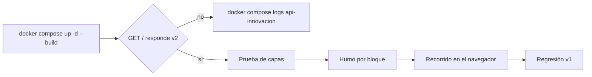

# Quickstart — Versión 2

> Cómo levantar el sistema y comprobar los 11 criterios de la
> [spec](2_spec.md). Lo que no cambia respecto a la v1 está en
> [v1_aliado/7_quickstart.md](../v1_aliado/7_quickstart.md).

## 1. Arranque

```powershell
# La primera vez: el archivo de secretos (Artículo 7, enmienda 1.1.0)
Copy-Item .env.example .env        # y cambie los valores
docker compose up -d --build
```

| Pieza | Dirección |
|---|---|
| Front Blazor | <http://localhost:8073> |
| API | <http://localhost:8072> · Swagger en `/swagger` |
| SQL Server | `localhost,11471` · usuario `sa` · clave: la de su `.env` |

¿Ya tenía la base de la v1? **No hace falta borrar el volumen**: la v2 no cambia
el esquema y `init.sh` corre las migraciones idempotentes en cada arranque.

## 2. El ciclo de validación



## 3. Comprobaciones automáticas

```powershell
# Criterio 9 — prueba de capas, SIN base de datos. Corre en un contenedor
# DESECHABLE (--rm) y sin levantar SQL Server (--no-deps). No use «exec» sobre
# el contenedor de la API: compilaría encima de la API en marcha y dotnet watch
# la reiniciaría.
docker compose run --rm --no-deps api-innovacion dotnet run --project pruebas/PruebaCapas.csproj

# Criterios 2 a 8 — humo de la API, un guion por bloque
python pruebas_humo/humo_academico.py
python pruebas_humo/humo_actividades.py
python pruebas_humo/humo_puentes.py

# Criterio 11 — regresión de la v1
python pruebas_humo/humo_front.py
```

Cada guion termina con `=== …: las N comprobaciones pasaron ===` y código de
salida 0, o lista lo que falló y sale con 1. Cada uno **construye su propia
cadena** por la API (facultad → programa → …) con llaves aleatorias y la retira
al final, de los hijos hacia los padres: no depende de datos sembrados y no deja
basura.

## 4. Recorrido manual (criterio 10)

1. Abrir <http://localhost:8073/facultades> → «Agregar»: la lista
   «Universidad (sede)» muestra las 6 sedes **traídas de la API**.
2. Crear una facultad, luego un programa en `/programas` (su lista
   «Facultad» ya muestra la nueva).
3. En `/acreditaciones`, crear una acreditación para ese programa.
4. Volver a `/programas` y «Retirar» el programa: aparece el aviso de que
   tiene registros que dependen de él. Retirar primero la acreditación y luego
   el programa: ahora sí.
5. En `/registros-calificados`, intentar guardar con la fecha de fin antes de
   la de inicio: aviso en rojo, nada se guarda.

## 5. Problemas conocidos

| Síntoma | Causa | Solución |
|---|---|---|
| `compose` dice «Falta MSSQL_SA_PASSWORD en .env» | No existe el `.env` | `Copy-Item .env.example .env` |
| `sqlserver-init` sale con error `\r: command not found` | `init.sh` quedó con fin de línea Windows | `git add --renormalize .` (lo evita `.gitattributes`) |
| La API tarda varios minutos la primera vez | `dotnet watch` restaura y compila dentro del contenedor | Esperar a que `docker compose logs -f api-innovacion` diga *Now listening* |
| SQL Server no arranca | La clave del `.env` no cumple la política (8+ caracteres con mayúscula, número y símbolo) | Cambiarla y `docker compose down -v` |
