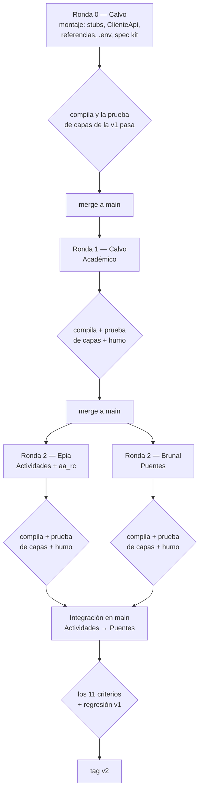

# Tareas — Versión 2

> Tres estudiantes, tres bloques, sin editar los mismos archivos en la misma
> ronda. El método es el del tutorial del curso: **ronda 0 de montaje** con
> archivos vacíos (*stubs*) para que nadie más toque los archivos
> compartidos, y después cada uno trabaja solo en los suyos.

## 0. El reparto

| Estudiante | Rol | Bloque de la v2 | Tablas |
|---|---|---|---|
| Sebastián Calvo | Encargado del `main` | Ronda 0 + **Académico** | `facultad`, `programa`, `acreditacion`, `registro_calificado` + protección de los padres de la v1 |
| David Epia | Desarrollador | **Actividades** | `activ_academica`, `pasantia`, `premio`, `docente_departamento`, `alianza`, `aa_rc` |
| Sebastián Brunal | Desarrollador | **Puentes** | `programa_ac`, `programa_pe`, `programa_ci`, `an_programa`, `enfoque_rc` |

¿Por qué así? El bloque Académico es la columna vertebral (`programa` es padre
de casi todo) y va con quien integra. En la API, Actividades y Puentes no
dependen de su código —dependen de `IRepositorioReferencias`, completo desde la
ronda 0—, pero **sus pantallas sí**: las listas desplegables de «Programa» usan
`ServicioPrograma`. Por eso el bloque Académico va primero (ronda 1) y los otros
dos van **en paralelo** en la ronda 2.

`aa_rc` va con Actividades y no con Puentes porque su pantalla necesita la
lista de actividades académicas (`ServicioActivAcademica`): si quedara en
Puentes, la rama de Brunal no compilaría sin la de Epia, y la ronda 2 dejaría de
ser paralela. Así, Epia y Brunal no comparten **ningún** archivo ni dependen el
uno del otro.

## 1. El orden, con sus compuertas

**Guía de lectura:** los rombos son compuertas: si no pasa, la rama no entra a
`main`. Las ramas de la ronda 2 nacen de `main` **después** de integrar el
bloque Académico. Entre ellas no hay orden obligatorio: no comparten archivos.

## 2. Qué archivo es de quién

| Archivo | Ronda 0 (Calvo) | Rondas 1 y 2 |
|---|---|---|
| `api_innovacion/Program.cs` | Llama a los 4 ensambladores | **Nadie lo toca** |
| `api_innovacion/Ensamblador/Ensamblador<Bloque>.cs` | Vacíos | Cada uno el suyo |
| `api_innovacion/Repositorios/IRepositorioReferencias.cs` y su implementación | **Completos** (los 22 recursos) | Nadie lo toca |
| `api_innovacion/pruebas/Programa.cs` | Llama a los 4 bloques | Nadie lo toca |
| `api_innovacion/pruebas/Pruebas<Bloque>.cs` | Vacíos | Cada uno el suyo |
| `front_blazor/Program.cs`, `NavMenu.razor`, `Home.razor`, `app.css` | Completos (los 22 enlaces) | Nadie los toca |
| `front_blazor/Ensamblador/Ensamblador<Bloque>.cs` | Vacíos | Cada uno el suyo |
| `pruebas_humo/comun.py` | Completo | Nadie lo toca |
| `pruebas_humo/humo_<bloque>.py` | — | Cada uno el suyo |
| Modelos, peticiones, repositorios, servicios, controladores, servicios y pantallas del front de cada tabla | — | Solo su responsable |
| Servicios de la v1 (`ServicioUniversidad`, …) — protección de padres | — | Calvo (bloque Académico) |

## 3. Ronda 0 — montaje (Calvo)

- [x] `.env.example`, `.gitignore`, `docker-compose.yml` y `appsettings.json` sin secretos (D-v2-2)
- [x] `db/init.sh` con migraciones idempotentes y `.gitattributes`
- [x] `Ensamblador/` en API y front, con la v1 movida y tres stubs
- [x] `IRepositorioReferencias` completo y sus tres excepciones
- [x] `ClienteApi` + `Resultado` en el front; los 7 servicios de la v1 adaptados sin cambiar su interfaz pública
- [x] Menú agrupado con los 22 enlaces y página de inicio
- [x] Prueba de capas repartida por bloque (`Verificador`, `PruebasV1`, stubs)
- [x] Constitución 1.1.0 y spec kit de la v2
- [x] **Compuerta:** compila API y front; prueba de capas de la v1 en verde

## 4. Ronda 1 — Académico (Calvo)

- [ ] API de `facultad`, `programa`, `acreditacion`, `registro_calificado`
- [ ] Reglas: tipo de facultad, orden de fechas del registro calificado
- [ ] Protección de padres en los 7 servicios de la v1 (RF9)
- [ ] Front: 4 servicios + 4 pantallas con listas desplegables
- [ ] `PruebasAcademico.cs` y `pruebas_humo/humo_academico.py`
- [ ] **Compuerta:** compila, prueba de capas, humo del bloque

## 5. Ronda 2 — Actividades (Epia)

- [ ] API de `activ_academica`, `pasantia`, `premio`, `docente_departamento`, `alianza`, `aa_rc`
- [ ] Reglas: créditos y horas no negativos, `espejo` 0/1, dedicación, orden de fechas
- [ ] Front: 6 servicios + 6 pantallas
- [ ] `PruebasActividades.cs` y `pruebas_humo/humo_actividades.py`
- [ ] **Compuerta:** compila, prueba de capas, humo del bloque

## 6. Ronda 2 — Puentes (Brunal)

- [ ] API de las 5 tablas puente puras (sin PUT/PATCH)
- [ ] Front: 5 servicios + 5 pantallas (sin «Editar»)
- [ ] `PruebasPuentes.cs` y `pruebas_humo/humo_puentes.py`
- [ ] **Compuerta:** compila, prueba de capas, humo del bloque

## 7. Cierre (Calvo, como encargado)

- [ ] Integrar en el orden de §1, volviendo a compilar y probar después de cada merge
- [ ] Prueba de humo completa de [7_quickstart.md](7_quickstart.md) + regresión v1
- [ ] [9_checklist.md](9_checklist.md) firmado
- [ ] `git tag v2` y `git push origin v2`

> El estado de las casillas de las rondas 1 de Epia y Brunal lo marcan ellos
> en sus ramas, cuando su compuerta pasa.
