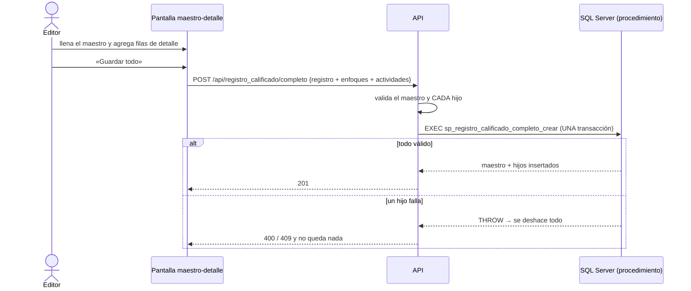

# Especificación — Maestro-detalle: registro calificado y programa

> **Delta sobre la v3** ([mapa](../0_mapa_versiones.md)). No cambia ninguna
> ruta existente: agrega cuatro. Ante conflicto manda la
> [constitución](../../1_constitution.md) (1.4.0).

## 1. Propósito

Hoy, para registrar un programa con sus áreas de conocimiento hay que crear el
programa y luego cada `programa_ac`, una petición por fila. Si la tercera
falla, el programa queda a medias. Esta entrega permite guardar un **maestro
con todo su detalle en una sola operación: o se guarda todo, o no se guarda
nada**.

## 2. Alcance

**Incluye**

| Maestro | Detalle |
|---|---|
| `registro_calificado` | `enfoque_rc` (sus enfoques) y `aa_rc` (sus actividades académicas, con componente y semestre) |
| `programa` | `programa_ac` (áreas de conocimiento), `programa_pe` (prácticas y estrategias) y `programa_ci` (características de innovación) |

- Crear el maestro con su detalle en una sola petición (todo o nada).
- Consultar el maestro con su detalle activo, con los nombres de cada hijo.
- Una pantalla por maestro: el maestro arriba y una tabla editable por cada
  detalle abajo (agregar y quitar filas).

**NO incluye** (Artículo 1)

- Editar o retirar «en bloque». Un maestro ya creado se edita con las
  pantallas de siempre: su tabla y la de cada relación.
- Otros maestros. Los demás padres siguen con su CRUD por tabla.

## 3. Requisitos funcionales

### MD1 — Crear un registro calificado con su detalle

`POST /api/registro_calificado/completo` recibe los campos del registro más
`enfoques` (lista de ids) y `actividades` (lista de `{activAcademicasIdcurso,
componente, semestre}`). Responde **201** con la llave y cuántos hijos guardó.

### MD2 — Consultar un registro calificado con su detalle

`GET /api/registro_calificado/{codigo}/completo` responde **200** con el
registro, sus enfoques activos y sus actividades activas, cada uno con su
nombre. Un registro inexistente o retirado responde **404**.

### MD3 — Crear un programa con su detalle

`POST /api/programa/completo` recibe los campos del programa más
`areasConocimiento`, `practicasEstrategias` y `caracteristicasInnovacion`
(listas de ids). Responde **201** con la llave y la cuenta de hijos.

### MD4 — Consultar un programa con su detalle

`GET /api/programa/{id}/completo`, igual que MD2.

### MD5 — Todo o nada

Si cualquier parte falla, **no queda nada**: ni el maestro ni los hijos
anteriores. Esto incluye que un padre se retire entre la validación y la
escritura, porque el procedimiento vuelve a comprobarlo dentro de la
transacción.

### MD6 — Las pantallas

`/registros-calificados/completo` y `/programas/completo`, en el menú
«Maestro-detalle»:

- arriba, consultar un maestro con su detalle (todos los roles);
- abajo, el formulario del maestro y una tabla editable por cada detalle, con
  «+ Agregar» y «Quitar» por fila (solo administrador y editor);
- un solo botón **«Guardar todo»**. Si falla, el formulario queda como estaba
  para corregir y reintentar.

## 4. Reglas

| Regla | Respuesta |
|---|---|
| Falta un campo del maestro o de un hijo (por ejemplo una actividad sin semestre) | **422** |
| Sin ningún hijo | **400**: para eso está el POST normal |
| Un hijo repetido en su lista | **400** |
| El padre del maestro (programa o facultad) o un hijo apunta a algo inexistente o retirado | **400** |
| `fechaFin` anterior a `fechaInicio` (registro) | **400**: la regla del maestro se conserva |
| La llave del maestro ya existe, aunque esté retirada | **409** |
| Sin token / rol insuficiente | **401** / **403**: GET todos los roles, POST administrador y editor |

## 5. Criterios de aceptación

1. Crear un registro con 2 enfoques y 2 actividades → 201, y cada hijo existe también en `enfoque_rc` y en `aa_rc`.
2. Si la **tercera** actividad no existe → 400, y el registro **no** se creó (404).
3. Llamando al procedimiento directamente con la segunda actividad mala → THROW 50400, y en la base no queda ni el maestro, ni el enfoque, ni la primera actividad.
4. Crear un programa con 2 áreas, 1 práctica y 1 característica → 201, y la consulta devuelve exactamente ese detalle.
5. Una característica inexistente en el programa → 400, y el programa no se creó.
6. Llave repetida → 409. Detalle vacío → 400. Hijo repetido → 400. Hijo sin campos → 422.
7. La prueba de capas comprueba que ningún intento fallido llega al repositorio.
8. Las dos pantallas guardan y muestran el maestro con su detalle. Un error se ve en rojo y no borra el formulario.

## 6. Clarificaciones

| # | Pregunta | Decisión |
|---|---|---|
| C1 | ¿Se puede crear un maestro-detalle sin hijos? | No (400): sería un POST normal con otra ruta |
| C2 | ¿Qué pasa si la llave del maestro existe pero está retirada? | 409, igual que el POST normal: no se reactiva en silencio |
| C3 | ¿El detalle se puede editar desde esta pantalla? | No en esta entrega: cada relación tiene ya su pantalla |
| C4 | ¿Un mismo hijo dos veces en la lista? | 400 antes de tocar la base; sería la misma llave dos veces |

## 7. Definición de TERMINADA

Los 8 criterios en verde con `python verificar_todo.py --limpio`, el spec kit
completo y la enmienda registrada.
