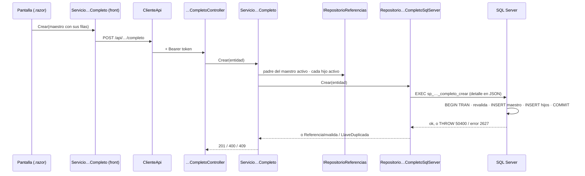

# Plan técnico — Maestro-detalle

## 1. Stack

El mismo (Artículo 2): C# + ASP.NET Core 10, Dapper, SQL Server 2022 y
Blazor Server. **Sin paquetes nuevos.** El detalle viaja a SQL Server como un
parámetro JSON que se lee con `OPENJSON`, que viene con el motor.

## 2. Qué se agrega

```
api_innovacion/
  Controllers/  RegistroCalificadoCompletoController.cs   POST completo · GET {codigo}/completo
                ProgramaCompletoController.cs              POST completo · GET {id}/completo
  Peticiones/   RegistroCalificadoCompletoCrear.cs          hereda RegistroCalificadoCrear + listas
                ProgramaCompletoCrear.cs                    hereda ProgramaCrear + listas
  Modelos/      RegistroCalificadoCompleto.cs               hereda RegistroCalificado + listas
                ProgramaCompleto.cs                         hereda Programa + listas
  Servicios/    IServicio…Completo + Servicio…Completo      reglas del maestro y de cada hijo
  Repositorios/ IRepositorio…Completo + …CompletoSqlServer  procedimiento (escribir) · QueryMultiple (leer)
  Ensamblador/  EnsambladorMaestroDetalle.cs                su propio archivo (D-v2-1)
  pruebas/      PruebasMaestroDetalle.cs                    20 comprobaciones sin base
db/migraciones/ v3_003_maestro_detalle.sql                  los 2 procedimientos
front_blazor/
  Servicios/    ServicioRegistroCalificadoCompleto.cs · ServicioProgramaCompleto.cs
  Components/Pages/ RegistrosCalificadosCompleto.razor · ProgramasCompleto.razor
  Ensamblador/  EnsambladorMaestroDetalle.cs
pruebas_humo/   humo_maestro_detalle.py                     49 comprobaciones contra la API y la base
```

## 3. La tubería de «Guardar todo»



## 4. Por qué cada pieza está donde está

| Pieza | Capa | Por qué |
|---|---|---|
| Validar cada hijo | Servicio | Da el mensaje claro del primer error y se prueba sin base de datos |
| Todo o nada | Procedimiento | Es la única forma de que la base garantice la atomicidad en un solo viaje; además revalida los padres dentro de la transacción |
| Traducir THROW 50400 y el error 2627 | Repositorio | El servicio nunca ve un tipo de SqlClient (Artículo 3) |
| Rutas bajo su tabla | Controlador | `/api/programa/completo` y no un `/api/maestro/{tabla}` (Artículo 10.1) |
| Controlador aparte | Controlador | Un recurso por clase: el CRUD de `programa` no cambia |

## 5. Chequeo de constitución

| Artículo | ¿Se cumple? |
|---|---|
| 1 — la spec manda | Sí: este spec kit se escribió antes de integrar |
| 2 — SQL a la vista, sin ORM, parametrizado | Sí: el JSON es un parámetro y las lecturas son SQL a mano. Los procedimientos los permite la **enmienda 1.4.0** |
| 3 — capas con interfaces | Sí: controlador → servicio → repositorio, con interfaces y repositorios falsos |
| 6 — borrado lógico | No se borra nada; las lecturas filtran `activo = 1` |
| 7 — secretos | Ninguno nuevo |
| 10 — códigos | 201 / 400 / 404 / 409 / 422, los mismos de siempre |
| 10.1 — rutas por recurso | Sí, bajo la ruta de cada tabla |
