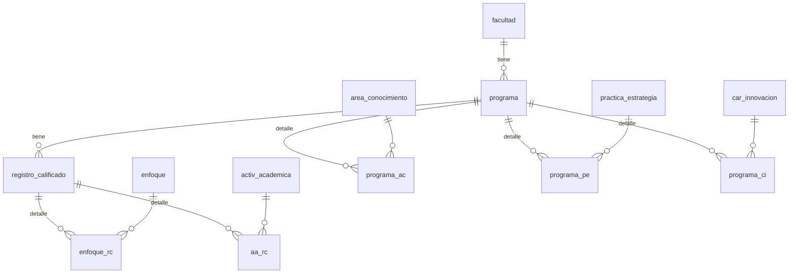

# Modelo de datos — Maestro-detalle

**No se crea ni se altera ninguna tabla** (Artículo 5). El maestro-detalle es
una forma de ESCRIBIR juntas tablas que ya existen.

## Los dos maestros

| Maestro | Su padre (se valida) | Detalle | Columnas del hijo que llegan en el JSON |
|---|---|---|---|
| `registro_calificado` (llave `codigo`) | `programa` | `enfoque_rc` | `enfoque` |
| | | `aa_rc` | `activ_academicas_idcurso`, `componente` (45), `semestre` (45) |
| `programa` (llave `id`) | `facultad` | `programa_ac` | `area_conocimiento` (VARCHAR 6) |
| | | `programa_pe` | `practica_estrategia` |
| | | `programa_ci` | `car_innovacion` |

La columna del hijo que apunta al maestro (`registro_calificado`,
`registro_calificado_codigo` o `programa`) **no viaja**: la pone el
procedimiento con la llave del maestro que acaba de insertar. Todos los
inserts llevan `activo = 1`.

## Migración `db/migraciones/v3_003_maestro_detalle.sql`

Idempotente (`CREATE OR ALTER`). Crea `sp_registro_calificado_completo_crear` y
`sp_programa_completo_crear`.

## Invariantes

1. Después de un POST completo que falla, la base queda **exactamente** como
   estaba.
2. Ningún hijo apunta a un padre retirado en el momento de guardarse.
3. Dentro de una misma lista, el detalle no repite llave.
