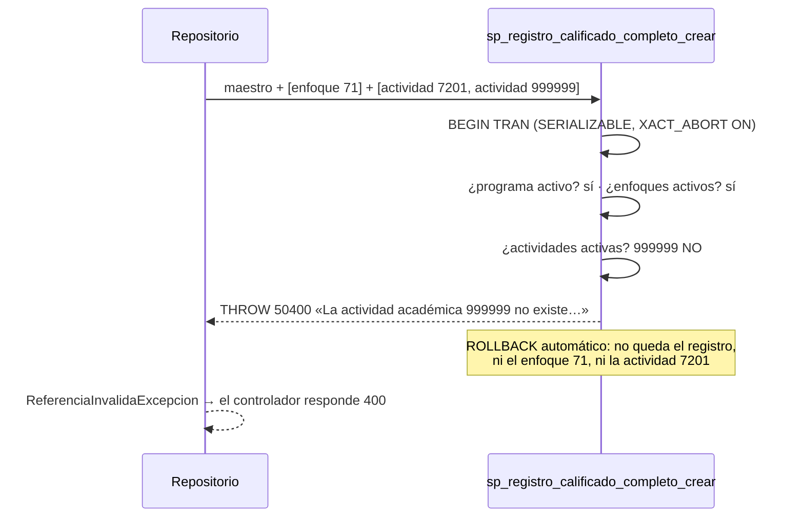

# Contratos HTTP — Maestro-detalle

> Mismo sobre de siempre (Artículo 10): errores `{estado, mensaje, detalle}`, y
> `errores:[…]` en el 422. Todas las rutas exigen JWT: **GET** para los tres
> roles y **POST** para administrador y editor.

## 1. `POST /api/registro_calificado/completo` — MD1

**Cuerpo:** los campos de `POST /api/registro_calificado`, todos obligatorios
y con las mismas validaciones, más:

```json
{
  "codigo": 7301, "cantCreditos": "160", "horaAcom": "48", "horaInd": "96",
  "metodologia": "Presencial", "fechaInicio": "2024-01-15", "fechaFin": "2031-01-15",
  "duracionAnios": "5", "duracionSemestres": "10", "tipoTitulacion": "Profesional",
  "programa": 7101,
  "enfoques": [71, 72],
  "actividades": [
    { "activAcademicasIdcurso": 7201, "componente": "Básico", "semestre": "1" }
  ]
}
```

| Código | Cuándo | Cuerpo |
|---|---|---|
| **201** | Se guardó todo | `{estado:201, mensaje, llave:{codigo}, detalle:{enfoques:2, actividades:1}}` |
| **422** | Falta un campo del registro o de una actividad, o un tipo no es válido | `errores:["El campo actividades[].semestre es obligatorio.", …]` |
| **400** | Sin hijos · hijo repetido · programa, enfoque o actividad inexistente o retirado · `fechaFin < fechaInicio` | `detalle` dice cuál, por ejemplo «La actividad académica 999999 no existe o está retirada.» |
| **409** | Ya existe un registro con ese código (aunque esté retirado) | «… No se guardó nada.» |
| **401 / 403** | Sin token / rol `consulta` | |

**En ningún caso distinto de 201 queda algo guardado.**

## 2. `GET /api/registro_calificado/{codigo}/completo` — MD2

**200:**

```json
{
  "codigo": 7301, "cantCreditos": "160", "…": "…", "programa": 7101,
  "enfoques": [ { "enfoque": 71, "nombre": "Constructivista" },
                { "enfoque": 72, "nombre": "Por competencias" } ],
  "actividades": [ { "activAcademicasIdcurso": 7201, "componente": "Básico",
                     "semestre": "1", "nombre": "Programación I" } ]
}
```

Solo trae los hijos **activos**. **404** si el registro no existe o está retirado.

## 3. `POST /api/programa/completo` — MD3

**Cuerpo:** los campos de `POST /api/programa` (con `fechaCierre` opcional) más:

```json
{
  "id": 7102, "nombre": "Ingeniería de Software", "…": "…", "facultad": 7001,
  "areasConocimiento": ["1A01", "1A02"],
  "practicasEstrategias": [73],
  "caracteristicasInnovacion": [74]
}
```

| Código | Cuándo |
|---|---|
| **201** | `{estado:201, mensaje, llave:{id}, detalle:{areasConocimiento:2, practicasEstrategias:1, caracteristicasInnovacion:1}}` |
| **422** | Falta un campo del programa |
| **400** | Sin hijos · hijo repetido · facultad, área, práctica o característica inexistente o retirada |
| **409** | Llave repetida |

## 4. `GET /api/programa/{id}/completo` — MD4

**200** con el programa y `areasConocimiento:[{areaConocimiento, nombre}]`,
`practicasEstrategias:[{practicaEstrategia, nombre}]` y
`caracteristicasInnovacion:[{carInnovacion, nombre}]`. **404** si no existe.

## 5. Los procedimientos (contrato con la base)

| Procedimiento | Parámetros | Errores |
|---|---|---|
| `sp_registro_calificado_completo_crear` | los 11 campos del registro · `@Enfoques` JSON `[int]` · `@Actividades` JSON `[{id, componente, semestre}]` | `THROW 50400` (padre o hijo inactivo) · 2627 (llave repetida) |
| `sp_programa_completo_crear` | los 11 campos del programa · `@Areas` JSON `[texto]` · `@Practicas` y `@Caracteristicas` JSON `[int]` | igual |

Con cualquier error la transacción se deshace entera (`XACT_ABORT ON`).

## 6. El todo-o-nada, dibujado


