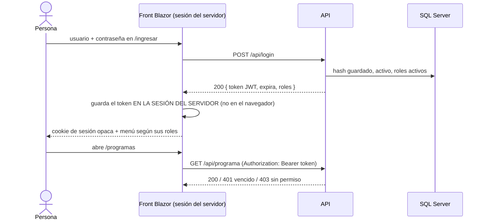

# Especificación — Entrega 3: JWT, sesiones y control de acceso por roles

> **Versión 3** ([mapa](../0_mapa_versiones.md)) · Crece sobre la v2 sin
> romperla. Ante conflicto manda la [constitución](../../1_constitution.md)
> (1.2.0).

## 1. Propósito

Que solo entre quien tiene usuario, y que cada quien pueda hacer **solo** lo
que su rol permite — comprobado en la API, no escondiendo botones. Y que el
administrador sea el único que gestiona usuarios y roles.

**Guía de lectura:** el navegador nunca ve el JWT: solo recibe una cookie que
identifica su sesión en el servidor del front, y es el front quien le agrega el
token a cada petición a la API.

## 2. Alcance

**Incluye**

- `POST /api/login` → JWT firmado (HS256) con el id, el usuario y sus roles.
- Validación del JWT en cada petición: firma, emisor, audiencia, vencimiento.
- Autorización por rol en la **API** para los 22 recursos del módulo.
- CRUD de `usuario`, `rol` y `rol_usuario`, **solo para administradores**.
- Contraseñas hasheadas (PBKDF2-SHA256 con sal), nunca en texto plano.
- Administrador inicial creado al arrancar con los datos del `.env`.
- Front: página de ingreso, sesión del servidor con el JWT adentro, envío del
  token en cada petición, menú y botones según el rol, panel de administración
  solo para administradores, cierre de sesión, y manejo de sesión vencida.

**NO incluye** (Artículo 1)

- Recuperar contraseña por correo, registro abierto, doble factor.
- Refresh tokens: al vencer el token se vuelve a ingresar (D-v3-6).
- Permisos por recurso distintos a los del verbo (no los pide el PDF).
- Dashboard y consultas: v4.

## 3. Requisitos funcionales

### RF1 — Ingresar
`POST /api/login` con `{usuario, clave}`.
- Correcto → **200** `{token, tipo: "Bearer", expira, usuario: {id, username, nombreCompleto, roles}}`.
- Usuario inexistente, retirado o clave equivocada → **401** con **el mismo
  mensaje** en los tres casos (no se revela qué usuarios existen).
- Credenciales correctas pero sin ningún rol activo → **403**.
- Falta un campo → **422**.

### RF2 — Exigir el token
Toda ruta `/api/*` salvo `/api/login` exige `Authorization: Bearer <token>`.
- Sin token → **401** «Falta el token…».
- Token adulterado o firmado con otra llave → **401** «El token no es válido».
- Token vencido → **401** «El token expiró. Vuelva a iniciar sesión.».
- `GET /` (diagnóstico) y `/swagger` siguen sin token.

### RF3 — Hashear las contraseñas
`usuario.password` guarda `pbkdf2-sha256$<iteraciones>$<sal>$<hash>`. Ninguna
respuesta de la API incluye la contraseña ni su hash.

### RF4 — Permisos por rol (en la API)

| Rol | GET | POST · PUT · PATCH | DELETE | usuario · rol · rol_usuario |
|---|---|---|---|---|
| `consulta` | ✔ | 403 | 403 | 403 |
| `editor` | ✔ | ✔ | 403 | 403 |
| `administrador` | ✔ | ✔ | ✔ | ✔ |

Es la regla del PDF: «administrador acceso completo incluyendo CRUD de usuarios
y roles; consulta solo puede ver; editor puede consultar y modificar, pero no
eliminar».

### RF5 — Administrar usuarios, roles y asignaciones (solo administrador)
- `/api/usuario`: listar, obtener, crear (con clave ≥ 8 caracteres y correo
  válido), reemplazar ficha (PUT, sin clave), actualizar (PATCH, puede traer una
  clave nueva) y retirar (lógico). Username o correo repetido → 409.
- `/api/rol`: CRUD con borrado lógico. Los tres roles del sistema no se retiran
  ni se renombran (409). Un rol con usuarios activos no se retira (409).
- `/api/rol_usuario`: asignar (`POST {usuarioId, rolId}`; 400 si alguno no está
  activo, 409 si ya lo tenía) y quitar (`DELETE /{usuarioId}/{rolId}`, lógico).
- **Nunca puede quedar el sistema sin administrador**: retirar al único
  administrador activo o quitarle su rol → 409.

### RF6 — Administrador inicial
Al arrancar, si no hay ningún administrador activo, la API crea (o restablece)
el usuario `ADMIN_USUARIO` con `ADMIN_CLAVE` y `ADMIN_CORREO` del `.env` y le
asigna el rol `administrador`. Si ya hay uno, no toca nada.

### RF7 — Front: ingreso y sesión
- Página `/ingresar` visible desde todas las pantallas sin sesión.
- Al ingresar, el JWT se guarda **en la sesión del servidor del front**; el
  navegador solo recibe una cookie de sesión `HttpOnly`.
- Toda petición del front a la API lleva `Authorization: Bearer <token>`.
- Sin sesión, cualquier pantalla redirige a `/ingresar`.

### RF8 — Front: menú y acciones según el rol
- El menú muestra solo lo que el rol puede usar; «Administración» solo al
  administrador.
- «Agregar» y «Editar» solo para administrador y editor; «Retirar» solo para
  administrador. (La API lo impide de todas formas: RF4.)

### RF9 — Front: panel de administración
Pantallas de usuarios, roles y asignaciones, accesibles solo con rol
administrador (un editor que escriba la dirección a mano ve «sin permiso»).

### RF10 — Front: cerrar sesión y sesión vencida
- «Cerrar sesión» destruye la sesión del servidor y con ella el token.
- Si la API responde 401 (token vencido), el front cierra la sesión y lleva a
  `/ingresar` con el aviso «Su sesión expiró».

## 4. Requisitos no funcionales

- **Ningún secreto en el repositorio**: `JWT_SECRETO`, `ADMIN_CLAVE` y
  `MSSQL_SA_PASSWORD` solo en `.env` (Artículo 7).
- La API **no arranca** si `JWT_SECRETO` falta o tiene menos de 32 caracteres.
- Un solo paquete nuevo: `Microsoft.AspNetCore.Authentication.JwtBearer`
  (enmienda 1.2.0 del Artículo 2). El hash usa lo que trae .NET.
- Regresión: los criterios de la v1 y la v2 siguen pasando, ahora con token.

## 5. Criterios de aceptación

1. `GET /` responde `"version":"v3"` sin token; `GET /api/universidad` sin token → 401.
2. Login correcto → 200 con token y roles; clave equivocada y usuario inexistente → 401 con el mismo mensaje; usuario retirado → 401; sin roles → 403.
3. Token adulterado, firmado con otra llave o vencido → 401, cada uno con su mensaje.
4. Consulta: GET 200, POST/PATCH/DELETE 403. Editor: GET/POST/PATCH 200, DELETE 403. Administrador: todo 200.
5. Editor y consulta reciben 403 en `/api/usuario`, `/api/rol` y `/api/rol_usuario`.
6. En la base, `usuario.password` empieza por `pbkdf2-sha256$`; ningún listado trae contraseñas.
7. El único administrador no se puede retirar ni perder su rol (409); los roles del sistema no se retiran (409).
8. Prueba de capas de la seguridad sin SQL Server.
9. Front: sin sesión, `/programas` redirige a `/ingresar`; con sesión, el menú corresponde al rol; «Cerrar sesión» vuelve a pedir ingreso.
10. Front: un editor no ve «Retirar» ni «Administración»; si entra a mano a `/admin/usuarios` ve «sin permiso».
11. Front: con un token vencido, la pantalla lleva a `/ingresar` con el aviso de sesión expirada.
12. Regresión de la v1 y la v2.

## 6. Clarificaciones

| # | Pregunta | Respuesta y razón | Dónde |
|---|---|---|---|
| C1 | ¿Qué roles hay y qué puede cada uno? | Los tres del PDF, con la tabla de RF4. Se aplican por verbo HTTP en un filtro global: ninguna tabla nueva puede olvidarse de pedirlos | D-v3-4 |
| C2 | ¿bcrypt o qué? | PBKDF2-SHA256 de .NET: «bcrypt o equivalente» dice la metodología, y este no exige paquete | D-v3-2 |
| C3 | El PDF dice «almacenamiento del JWT en la sesión del servidor». ¿Cookie, localStorage, memoria? | Sesión del servidor del front: el ticket con el JWT vive en la memoria del servidor y el navegador solo tiene una cookie opaca `HttpOnly`. Un script en la página no puede leer el token | D-v3-7 |
| C4 | ¿Cómo se crea el primer administrador sin escribir su clave en el repo? | La API lo crea al arrancar con el `.env` (RF6). Una migración SQL obligaría a versionar la clave o su hash | D-v3-5 |
| C5 | ¿Y si borran el último administrador? | No se puede: 409 (RF5) | RF5 |
| C6 | ¿Cuánto dura un token y qué pasa al vencer? | `JWT_MINUTOS` (60 por defecto). Sin refresh token: al vencer, el front cierra la sesión y pide ingresar | D-v3-6 |
| C7 | `rol_usuario` no tiene `activo`. ¿Quitar un rol es un DELETE físico? | No: la migración `v3_001` le agrega `activo` (Artículo 6) | 5_data_model |
| C8 | `rol.activo` y `usuario.activo` admiten NULL en el script del curso | Se normalizan a 1 y se vuelven NOT NULL en `v3_001`: un NULL quedaba escondido por los filtros sin que nadie lo hubiera retirado | 5_data_model |
| C9 | ¿Los roles nuevos que cree el administrador dan permisos? | No: los permisos están escritos con los tres nombres del sistema. Un rol nuevo sirve para clasificar, no autoriza nada, y eso se dice en la pantalla | D-v3-4 |
| C10 | ¿Por qué el usuario inexistente da 401 igual que la clave equivocada? | Para no permitir enumerar usuarios probando nombres | RF1 |

No queda ningún `[NECESITA ACLARACIÓN]`.

## 7. Definición de TERMINADA

Los 12 criterios con la evidencia de [7_quickstart.md](7_quickstart.md), el
[9_checklist.md](9_checklist.md) firmado, las tres ramas integradas en el
orden de [8_tasks.md](8_tasks.md) y **tag `v3`**.
