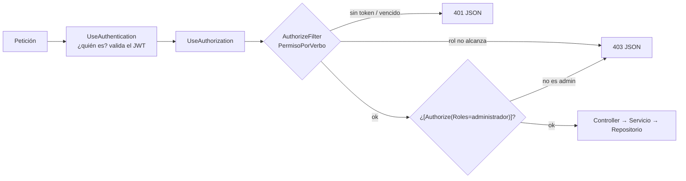

# Plan técnico — Versión 3

## 1. Stack

Igual que la v2, más un paquete en la API:
`Microsoft.AspNetCore.Authentication.JwtBearer` 10.0.13 (D-v3-1). El front no
agrega paquetes: la autenticación por cookie viene en ASP.NET Core.

## 2. Qué se agrega

| Dónde | Archivo | Para qué |
|---|---|---|
| API · `Seguridad/` | `Roles`, `OpcionesJwt`, `IHasheadorClaves` + `HasheadorClavesPbkdf2`, `IGeneradorToken` + `GeneradorTokenJwt`, `PermisoPorVerbo` | Las piezas de seguridad, cada una detrás de su interfaz |
| API | `Modelos/Usuario.cs`, `Modelos/Rol.cs` | Entidades; `Usuario` **sin** contraseña; `CredencialesUsuario` solo para el ingreso |
| API | `Peticiones/LoginPeticion`, `Usuario*`, `Rol*`, `RolUsuarioCrear` | Un cuerpo por verbo |
| API | `Repositorios/` y `Servicios/` de usuario, rol, rol_usuario y autenticación | Mismo patrón de capas |
| API | `Controllers/Login`, `Usuario`, `Rol`, `RolUsuario` | Login anónimo; los otros tres solo administrador |
| API | `Ensamblador/EnsambladorSeguridad.cs` | `AgregarSeguridad` (servicios, JWT, política, filtro global, Swagger) y `UsarSeguridad` (middlewares + administrador inicial) |
| Base | `db/migraciones/v3_001_seguridad.sql` | Tres roles, `activo` NOT NULL en rol/usuario, `activo` en rol_usuario |
| Docker | `docker-compose.yml`, `.env.example` | `JWT_SECRETO`, `JWT_MINUTOS`, `ADMIN_*` |
| Front (Epia) | `Components/Cuenta/`, `Servicios/ProveedorToken.cs`, `Ensamblador/EnsambladorSesion.cs`, `ClienteApi`, menú, 22 pantallas | Sesión y permisos en pantalla |
| Front (Brunal) | `Components/Pages/Admin/`, servicios de administración | Panel del administrador |

## 3. La tubería de una petición

## 4. Decisiones aterrizadas

- **El filtro es global y lo abierto se declara** (`[AllowAnonymous]` solo en
  `/api/login`). D-v3-4.
- **401 y 403 con el sobre del contrato**: `JwtBearerEvents.OnChallenge` y
  `OnForbidden` escriben `{estado, mensaje, detalle}`. El 401 distingue «falta»,
  «no es válido» y «expiró».
- **`ClockSkew` de 30 s**: el valor por defecto (5 min) haría que un token
  vencido siguiera sirviendo cinco minutos.
- **El token lleva `role` con el nombre corto** del estándar, no el URI largo
  de .NET (lo detectó la prueba de capas).
- **El JWT en la sesión del servidor del front** (D-v3-7): cookie `HttpOnly`
  opaca + `ITicketStore` en memoria.

## 5. Chequeo de constitución

| Artículo | ¿Cumple? |
|---|---|
| 1 — por versiones | Sí: nada de la v4 |
| 1.1 — su front | Sí: rondas 4 y 5 |
| 2 — paquetes | Sí, con la **enmienda 1.2.0** (JwtBearer) |
| 3 — capas | Sí: seguridad detrás de interfaces; ensamblador `EnsambladorSeguridad` |
| 6 — borrado lógico | Sí: usuario, rol y rol_usuario |
| 7 — secretos | Sí: `JWT_SECRETO` y `ADMIN_CLAVE` solo en `.env`; la API no arranca con un secreto corto |
| 9 — contratos | Sí: [6_contracts.md](6_contracts.md), 401/403 incluidos |
| 10 — códigos | Sí, con la **enmienda 1.2.0** (401 y 403) |
