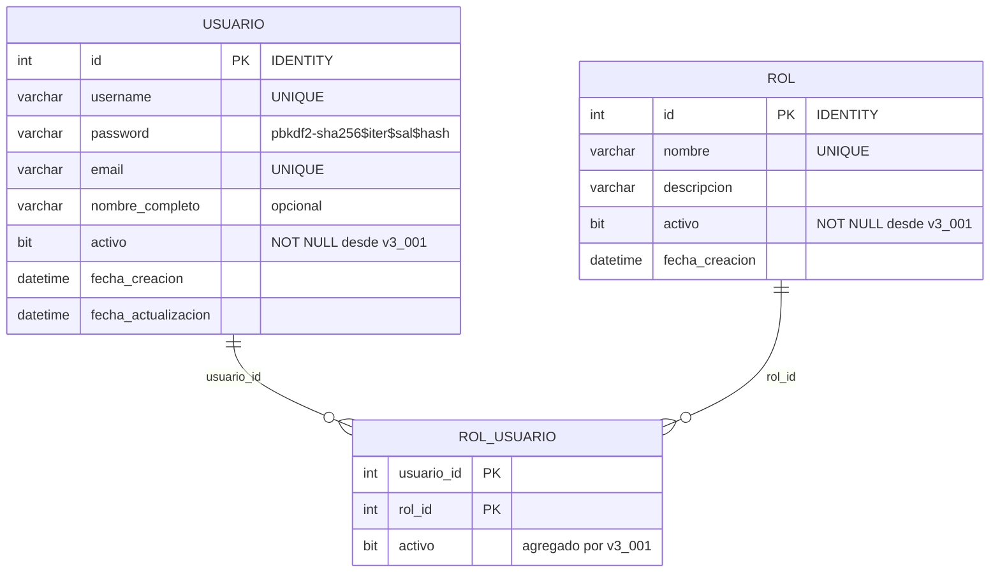

# Modelo de datos — Versión 3

Las tres tablas de gestión de usuarios existen desde la v1 (Artículo 5). La v3
las usa por primera vez y les aplica una migración idempotente.

## Migración `db/migraciones/v3_001_seguridad.sql`

| Cambio | Por qué | Idempotente porque… |
|---|---|---|
| Inserta `administrador`, `editor`, `consulta` | Los permisos están escritos con esos nombres | `IF NOT EXISTS` por nombre |
| `rol.activo` y `usuario.activo` → NULL a 1 y `NOT NULL` | Un NULL quedaba escondido por los filtros `activo = 1` | El `UPDATE` no encuentra NULL la segunda vez; `ALTER COLUMN` a lo mismo no cambia nada |
| `rol_usuario.activo BIT NOT NULL DEFAULT 1` | Quitar un rol debe ser borrado lógico (Artículo 6) | `IF COL_LENGTH(...) IS NULL` |

No hay `INSERT` de usuarios: el administrador inicial lo crea la API (D-v3-5).

## Invariantes

| Invariante | Quién la defiende |
|---|---|
| Ninguna respuesta incluye `password` | `Usuario` no tiene esa propiedad; solo `CredencialesUsuario` la lee, y no sale del servicio de ingreso |
| Siempre hay al menos un administrador activo | `ServicioUsuario.Eliminar` y `ServicioRolUsuario.Quitar` → 409 |
| Los tres roles del sistema existen y no se renombran | La migración y `ServicioRol` → 409 |
| Un rol cuenta solo si el rol Y la asignación están activos | `RepositorioUsuarioSqlServer.RolesActivos` |
