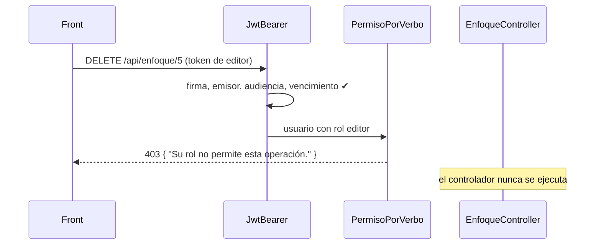

# Contratos HTTP — Versión 3

> Todo `/api/*` exige `Authorization: Bearer <token>` salvo `POST /api/login`.
> Los contratos de la v1 y la v2 no cambian; se les suman el 401 y el 403.

## 0. Errores de seguridad

| Código | Cuándo | Cuerpo |
|---|---|---|
| 401 | Sin token | `{"estado":401,"mensaje":"No autenticado.","detalle":"Falta el token. Inicie sesión en POST /api/login y envíelo en Authorization: Bearer <token>."}` |
| 401 | Token adulterado o firmado con otra llave | `… "detalle":"El token no es válido."` |
| 401 | Token vencido | `… "detalle":"El token expiró. Vuelva a iniciar sesión."` |
| 403 | Token válido, rol insuficiente | `{"estado":403,"mensaje":"Sin permiso.","detalle":"Su rol no permite esta operación."}` |

## 1. `POST /api/login`

```json
POST /api/login
{ "usuario": "admin", "clave": "…" }
```
```json
200
{
  "token": "eyJhbGciOiJIUzI1NiIs…",
  "tipo": "Bearer",
  "expira": "2026-10-22T21:30:00Z",
  "usuario": { "id": 1, "username": "admin", "nombreCompleto": "Administrador del sistema", "roles": ["administrador"] }
}
```

| Caso | Respuesta |
|---|---|
| Usuario inexistente, retirado o clave equivocada | 401 `"detalle":"Usuario o contraseña incorrectos."` (el mismo en los tres) |
| Correcto pero sin roles activos | 403 |
| Falta `usuario` o `clave` | 422 |

El token (HS256) lleva: `sub` (id), `unique_name`, `name`, `role` (uno por
rol), `jti`, `iss = innovacion-api`, `aud = innovacion-front`, `nbf`, `exp`.

## 2. Permisos por verbo (los 22 recursos del módulo)

| Verbo | administrador | editor | consulta |
|---|---|---|---|
| GET | 200 | 200 | 200 |
| POST · PUT · PATCH | ✔ | ✔ | 403 |
| DELETE | ✔ | 403 | 403 |

## 3. `/api/usuario` — solo administrador

| Verbo | Ruta | Cuerpo | Respuestas |
|---|---|---|---|
| GET | `/api/usuario?limite=N` | — | 200 `{tabla, limite, total, datos:[{id, username, email, nombreCompleto, fechaCreacion, fechaActualizacion, roles}]}` · 204 |
| GET | `/api/usuario/{id}` | — | 200 · 404 |
| POST | `/api/usuario` | `{username, clave (≥8), email, nombreCompleto?}` | 201 `{llave:{id}}` · 422 · 409 username/correo repetido |
| PUT | `/api/usuario/{id}` | `{username, email, nombreCompleto?}` (sin clave) | 200 · 422 · 404 · 409 |
| PATCH | `/api/usuario/{id}` | cualquiera de `{username, email, nombreCompleto, clave}` | 200 · 400 vacío · 404 · 409 |
| DELETE | `/api/usuario/{id}` | — | 200 · 404 · 409 único administrador |

## 4. `/api/rol` — solo administrador

| Verbo | Ruta | Cuerpo | Respuestas |
|---|---|---|---|
| GET | `/api/rol` · `/api/rol/{id}` | — | 200 · 204 · 404 |
| POST | `/api/rol` | `{nombre, descripcion?}` | 201 `{llave:{id}}` · 409 nombre repetido |
| PUT / PATCH | `/api/rol/{id}` | `{nombre, descripcion?}` | 200 · 404 · 409 (renombrar un rol del sistema) |
| DELETE | `/api/rol/{id}` | — | 200 · 404 · 409 rol del sistema o con usuarios activos |

## 5. `/api/rol_usuario` — solo administrador

| Verbo | Ruta | Cuerpo | Respuestas |
|---|---|---|---|
| GET | `/api/rol_usuario` | — | 200 `{datos:[{usuarioId, rolId, username, rol}]}` · 204 |
| GET | `/api/rol_usuario/{usuarioId}/{rolId}` | — | 200 · 404 |
| POST | `/api/rol_usuario` | `{usuarioId, rolId}` | 201 · 400 usuario o rol no activo · 409 ya lo tenía |
| DELETE | `/api/rol_usuario/{usuarioId}/{rolId}` | — | 200 · 404 · 409 último administrador |

## 6. El 401 y el 403, dibujados


