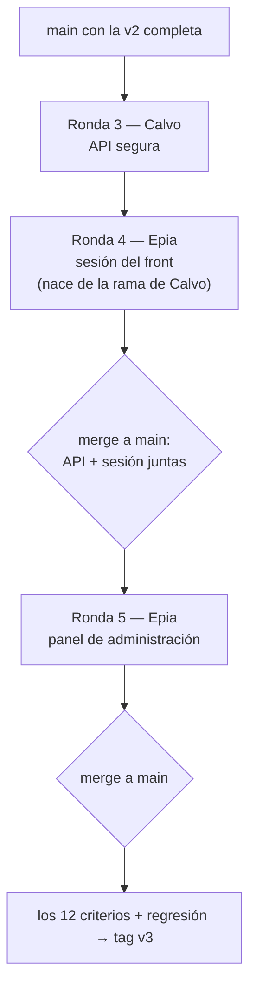

# Tareas — Versión 3

## 0. El reparto

> **Equipo de dos.** Sebastián Brunal salió del grupo antes de la entrega 2. El reparto quedó entre Sebastián Calvo y David Epia: David tomó también el bloque que estaba pensado para un tercer estudiante. Las ramas `feature/sebastian-brunal-…` conservan el nombre del reparto inicial, pero su trabajo lo hizo y lo subió David (los commits están a su nombre).

| Estudiante | Ronda | Rama | Qué hace |
|---|---|---|---|
| Sebastián Calvo | 3 | `feature/sebastian-calvo-entrega3-api-seguridad` | Toda la seguridad de la **API**: login, JWT, hash, permisos, CRUD de usuario/rol/rol_usuario, migración, administrador inicial, spec kit de la v3 |
| David Epia | 4 | `feature/david-epia-entrega3-sesion-front` | **Sesión en el front**: `/ingresar`, sesión del servidor con el JWT, token en cada petición, sesión vencida, cerrar sesión, menú y botones por rol, actualización de `humo_front.py` |
| David Epia | 5 | `feature/sebastian-brunal-entrega3-admin-front` | **Panel de administración** en el front: usuarios, roles y asignaciones, solo para administradores |

## 1. El orden, y por qué

**Guía de lectura:** la API segura sin la sesión del front deja las pantallas
respondiendo 401 —el front todavía no sabe mandar el token—. Por eso la rama de
Epia **nace de la de Calvo** y las dos entran juntas a `main`. El panel de
administración necesita la sesión (sus páginas exigen rol administrador), así que va
después.

## 2. Ronda 3 — API segura (Calvo)

- [x] `Seguridad/`: roles, opciones JWT validadas al arrancar, hash PBKDF2, generador de tokens, permiso por verbo
- [x] `POST /api/login` con 401 único, 403 sin roles y 422
- [x] Filtro global de permisos y 401/403 con el sobre del contrato
- [x] CRUD de `usuario`, `rol`, `rol_usuario` solo para administrador, con las reglas de RF5
- [x] Migración idempotente `v3_001_seguridad.sql` y administrador inicial desde el `.env`
- [x] Swagger con «Authorize»
- [x] `PruebasSeguridad.cs` (25 comprobaciones) y `pruebas_humo/humo_seguridad.py` (54)
- [x] `comun.py` inicia sesión solo: los humos de la v2 pasan sin cambios
- [x] Constitución 1.2.0 y spec kit de la v3

## 3. Ronda 4 — sesión del front (Epia)

- [ ] `Components/Cuenta/Ingresar.razor` (formulario SSR con antifalsificación) y `SinPermiso.razor`
- [ ] Autenticación por cookie con sesión del servidor (`ITicketStore` en memoria) y el JWT como claim del ticket
- [ ] `ProveedorToken` + `ClienteApi` enviando `Authorization: Bearer`; 401 → sesión vencida; 403 → aviso
- [ ] `Routes.razor` con `AuthorizeRouteView`; `[Authorize]` en todas las pantallas
- [ ] Menú con `AuthorizeView` (grupo «Administración» solo para administrador), usuario y «Cerrar sesión»
- [ ] Botones «Agregar/Editar» para administrador y editor, «Retirar» solo administrador, en las 22 pantallas
- [ ] `humo_front.py` inicia sesión por el formulario
- [ ] **Compuerta:** criterios 9, 10 y 11 + regresión

## 4. Ronda 5 — panel de administración (Epia)

- [ ] `ServicioUsuario`, `ServicioRol`, `ServicioRolUsuario` en el front
- [ ] Pantallas `/admin/usuarios`, `/admin/roles`, `/admin/asignaciones` con `[Authorize(Roles = "administrador")]`
- [ ] Registrar los servicios en `Ensamblador/EnsambladorAdministracion.cs`
- [ ] **Compuerta:** un administrador crea un usuario, le asigna rol, y ese usuario ingresa; un editor ve «sin permiso»

## 5. Cierre (Calvo)

- [ ] Integrar en el orden de §1, probando después de cada merge
- [ ] [9_checklist.md](9_checklist.md) firmado y `tag v3`
