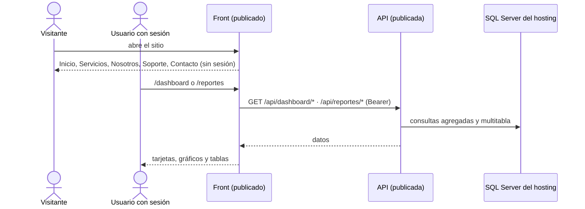

# Especificación — Entrega 4: reportes, dashboard, sitio corporativo y publicación

> **Versión 4** ([mapa](../0_mapa_versiones.md)) · Crece sobre la v3 sin
> romperla. Ante conflicto manda la [constitución](../../1_constitution.md)
> (1.5.0).

## 1. Propósito

Convertir el sistema en un **aplicativo web completo** con estas partes:
- una cara pública con la imagen de la Universidad Monte Verde;
- **reportes** que cruzan la información de varias tablas;
- un **dashboard** con las cifras clave;
- adaptado a cualquier pantalla, instalable como PWA;
- **publicado** en un servidor gratuito.

## 2. Alcance

**Incluye**

| Parte | Entregable del enunciado |
|---|---|
| API | 10 consultas multitabla (4 tablas o más cada una) como endpoints · endpoints con datos agregados para el dashboard · API documentada (Swagger con descripciones) |
| Front | Páginas corporativas (Inicio, Productos/Servicios, Soporte, Contacto, Sobre nosotros) · imagen corporativa del manual (logo, colores, tipografía) · módulo de reportes · dashboard con gráficos · responsive · PWA |
| Datos | Escenario de demostración para que reportes y dashboard muestren algo (migración `v4_001`) |
| Publicación | Sitio en servidor gratuito · todas las ramas integradas en `main` · URL del sitio y enlace del repositorio |

**NO incluye** (Artículo 1)

- Filtros por fecha o por sede en los reportes: los diez muestran todo lo activo.
- Exportar a PDF o Excel nativo. Hay CSV (lo abre Excel) e impresión del navegador.
- Funcionar sin conexión con datos. Blazor Server necesita la conexión; la PWA
  se instala y muestra una página «sin conexión» (D-v4-6).

## 3. Requisitos funcionales

### RF1 — Las 10 consultas multitabla

Cada una tiene **su ruta**, une **4 tablas o más** y filtra `activo = 1` en
**todas** las tablas que toca:

| # | Ruta `GET /api/reportes/…` | Tablas |
|---|---|---|
| R1 | `programas-acreditados` | acreditacion · programa · facultad · universidad |
| R2 | `registros-con-enfoques` | registro_calificado · programa · facultad · enfoque_rc · enfoque |
| R3 | `plan-de-estudios` | aa_rc · registro_calificado · programa · activ_academica |
| R4 | `areas-por-facultad` | facultad · programa · programa_ac · area_conocimiento |
| R5 | `innovacion-por-programa` | programa · facultad · programa_ci · car_innovacion · programa_pe · practica_estrategia |
| R6 | `alianzas-vigentes` | alianza · aliado · programa · facultad · universidad |
| R7 | `normatividad-por-programa` | an_programa · aspecto_normativo · programa · facultad |
| R8 | `internacionalizacion` | programa · facultad · pasantia · premio |
| R9 | `docentes-por-sede` | docente_departamento · programa · facultad · universidad |
| R10 | `cursos-espejo` | activ_academica · programa · facultad · universidad |

`GET /api/reportes` devuelve el **catálogo**: ruta, título, descripción y tablas de cada reporte.

### RF2 — Datos agregados del dashboard

- `GET /api/dashboard/resumen`: las cifras de las tarjetas.
- Seis series `{etiqueta, valor}`:
  - programas por nivel;
  - programas por sede;
  - acreditaciones por calificación;
  - registros por metodología;
  - docentes por dedicación;
  - graduados por facultad. Esta acepta `?maximo=N`: las N principales y el resto en «Otras».

### RF3 — API documentada

Swagger (`/swagger`) describe **cada** endpoint con su resumen, tomado de los
comentarios `///` del código. Tiene título y versión, y explica cómo autenticarse.

### RF4 — Páginas corporativas

`/`, `/servicios`, `/nosotros`, `/soporte` y `/contacto`:
- son **públicas** y **estáticas**, y no llaman a la API;
- desde Inicio se llega a «Ingresar»;
- la aplicación (antes en `/`) pasa a `/aplicacion`.

### RF5 — Imagen corporativa

Logo, colores y tipografía del [manual de marca](../../../MANUAL_DE_MARCA.md)
(Artículo 12):
- el logo va sobre banda blanca;
- verde institucional en la barra y el acento;
- **Merriweather** en los títulos e **Inter** en el texto.

### RF6 — Módulo de reportes

`/reportes`:
- el catálogo a un lado y la tabla del reporte elegido al otro;
- muestra las tablas que une cada reporte;
- descarga en **CSV** e **impresión**.

### RF7 — Dashboard

`/dashboard`:
- 10 tarjetas con las cifras;
- 6 gráficos de barras horizontales, cada uno con su tabla de datos («Ver los datos»).

### RF8 — Responsive

Todas las páginas funcionan desde 360 px de ancho sin desplazamiento
horizontal. En el celular el menú se pliega tras «☰ Menú».

### RF9 — PWA

- Manifiesto con íconos y el color del manual: el sitio se puede instalar.
- Service worker que guarda los estáticos de la marca y muestra `offline.html` sin conexión.

### RF10 — Publicación

- API y front en un servidor gratuito para ASP.NET Core, con su base SQL Server.
- Los secretos van en variables del servidor, nunca en el repositorio.
- Todas las ramas integradas en `main` y tag `v4`.

## 4. Criterios de aceptación

1. Los 10 reportes responden 200, con filas y con sus columnas. El catálogo dice que todos unen 4 tablas o más.
2. Un registro retirado deja de aparecer en los reportes.
3. El resumen del dashboard cuenta lo mismo que los listados. Cada serie suma su total. `maximo=0` → 400.
4. Sin token, reportes y dashboard → 401. Sin sesión, `/reportes` y `/dashboard` → `/ingresar`.
5. Swagger documenta los 10 reportes y los 7 endpoints del dashboard, cada uno con su descripción.
6. Las 5 páginas corporativas responden sin sesión, y la principal ofrece «Ingresar».
7. El sitio usa el logo y la tipografía del manual.
8. El manifiesto es instalable (standalone, con íconos) y el service worker y `offline.html` responden.
9. Reportes y dashboard se ven en el navegador. El dashboard y el menú se ven bien a 375 px.
10. La publicación compila en Release, prepara la base y la aplicación publicada arranca en modo Production.
11. Regresión: todas las pruebas anteriores siguen en verde.

## 5. Clarificaciones

| # | Pregunta | Decisión |
|---|---|---|
| C1 | ¿Las páginas corporativas muestran datos vivos? | No. Son públicas y la API exige token; mostrar cifras sin sesión obligaría a abrir un endpoint anónimo. Las cifras están en el dashboard, con sesión |
| C2 | ¿«Productos/Servicios»? | En una universidad son los **servicios del sistema** para cada dependencia: página `/servicios` |
| C3 | ¿El formulario de contacto guarda mensajes? | No: abre el correo de quien escribe (`mailto:`). El sistema no recoge datos personales de visitantes |
| C4 | ¿Con qué datos se ven los reportes? | Con el escenario de demostración de `v4_001_datos_demo.sql`, que no pisa lo que ya exista |
| C5 | ¿Dos servidores o uno? | El plan gratuito de MonsterASP permite un sitio por cuenta: API y front van en dos cuentas, una por integrante (D-v4-7) |

## 6. Definición de TERMINADA

- `python verificar_todo.py --limpio` en verde.
- El sitio publicado y accesible, con su URL en el README.
- Tag `v4`.
