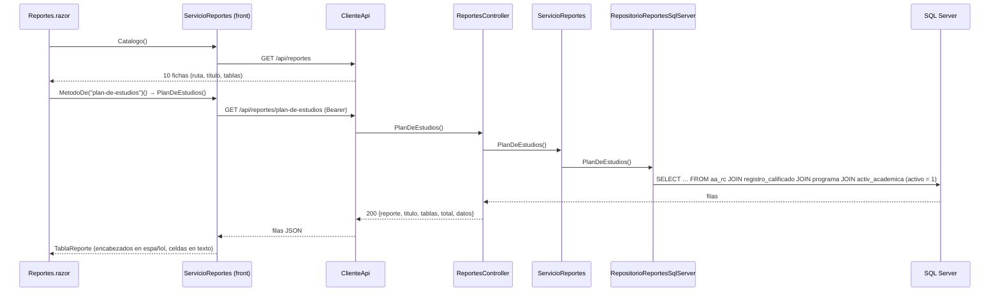
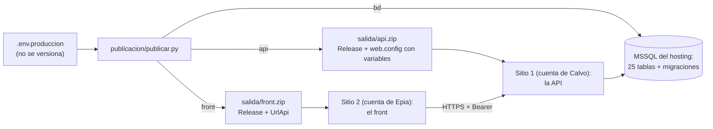

# Plan técnico — Versión 4

## 1. Stack

El mismo (Artículo 2), **sin paquetes nuevos**:

| Necesidad | Solución |
|---|---|
| Documentación | El XML de comentarios lo genera el compilador (`GenerateDocumentationFile`) y Swashbuckle ya lo lee |
| Gráficos | HTML y CSS (D-v4-3) |
| PWA | Un manifiesto y un service worker escritos a mano |

## 2. Qué se agrega

```
api_innovacion/
  Controllers/  ReportesController.cs     GET /api/reportes y las 10 rutas
                DashboardController.cs    GET /api/dashboard/resumen y 6 series
  Modelos/      Reportes.cs               una clase de fila por reporte + ResumenDashboard + DatoGrafico
  Servicios/    IServicioReportes / ServicioReportes     catálogo (título, tablas) + las 10 consultas
                IServicioDashboard / ServicioDashboard   series + regla «Otras»
  Repositorios/ IRepositorioReportes / RepositorioReportesSqlServer     las 10 consultas SQL a la vista
                IRepositorioDashboard / RepositorioDashboardSqlServer   COUNT / SUM / GROUP BY
  Ensamblador/  EnsambladorReportes.cs
  pruebas/      PruebasReportes.cs        (+9 comprobaciones sin base)
db/migraciones/ v4_001_datos_demo.sql     escenario de demostración, idempotente
front_blazor/
  Components/Corporativo/  Inicio · PaginaServicios · Nosotros · Soporte · Contacto   (públicas)
  Components/Pages/        Reportes.razor · Dashboard.razor · Home.razor → /aplicacion
  Components/Graficos/     GraficoBarras.razor
  Servicios/               ServicioReportes (un método por reporte) · ServicioDashboard
  wwwroot/                 manifest.webmanifest · service-worker.js · offline.html · iconos/ · marca/
pruebas_humo/   humo_reportes.py          (74 comprobaciones: API, Swagger, front y PWA)
publicacion/    publicar.py · .env.produccion.example
```

## 3. La tubería de un reporte



## 4. Publicación



## 5. Chequeo de constitución

| Artículo | ¿Se cumple? |
|---|---|
| 1 — la spec manda | Sí: este spec kit acompaña la versión |
| 2 — SQL a la vista, sin paquetes nuevos | Sí: las 10 consultas escritas completas en el repositorio. Ningún paquete agregado |
| 3 — capas | Controlador → servicio → repositorio, con repositorios falsos en la prueba de capas |
| 6 — borrado lógico | Las consultas filtran `activo = 1` en cada tabla |
| 7 — secretos | `.env.produccion` y `publicacion/salida/` en el `.gitignore`. Los secretos solo viajan en el web.config del servidor |
| 10 / 10.1 — rutas por recurso | Una ruta por reporte y por gráfico (enmienda 1.5.0) |
| 12 — identidad visual | La aplicación usa las variables de `marca.css`: verde, Merriweather e Inter (antes el acento era azul) |
