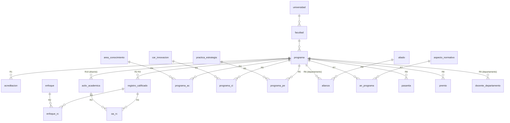

# Modelo de datos — Versión 4

**No se crea ni se altera ninguna tabla** (Artículo 5). La v4 **lee**: une
las tablas que ya existen en 10 consultas y las agrega para el dashboard.

## Qué tablas usa cada reporte

| Reporte | Tablas | N.º |
|---|---|---|
| R1 programas-acreditados | acreditacion, programa, facultad, universidad | 4 |
| R2 registros-con-enfoques | registro_calificado, programa, facultad, enfoque_rc, enfoque | 5 |
| R3 plan-de-estudios | aa_rc, registro_calificado, programa, activ_academica | 4 |
| R4 areas-por-facultad | facultad, programa, programa_ac, area_conocimiento | 4 |
| R5 innovacion-por-programa | programa, facultad, programa_ci, car_innovacion, programa_pe, practica_estrategia | 6 |
| R6 alianzas-vigentes | alianza, aliado, programa, facultad, universidad | 5 |
| R7 normatividad-por-programa | an_programa, aspecto_normativo, programa, facultad | 4 |
| R8 internacionalizacion | programa, facultad, pasantia, premio | 4 |
| R9 docentes-por-sede | docente_departamento, programa, facultad, universidad | 4 |
| R10 cursos-espejo | activ_academica, programa, facultad, universidad | 4 |

## Migración `db/migraciones/v4_001_datos_demo.sql`

| Tabla | Filas sembradas | Llaves |
|---|---|---|
| enfoque · practica_estrategia · car_innovacion · aspecto_normativo | 5 c/u | 11–15 · 21–25 · 31–35 · 41–45 |
| aliado | 5 | NIT 900100001–900100005 |
| facultad | 6 | 101–106 (sobre las universidades 1–5 del curso) |
| programa | 12 | 201–212 |
| acreditacion · registro_calificado | 7 · 12 | 3001–3007 · 4001–4012 |
| activ_academica · pasantia · premio | 14 · 7 · 5 | 501–514 · 601–607 · 701–705 |
| programa_ac / _pe / _ci · an_programa · enfoque_rc · aa_rc | 13 · 11 · 12 · 12 · 15 · 14 | combinaciones de las anteriores |
| docente_departamento · alianza | 15 · 8 | docentes 10001–10015 |

Es **idempotente**: cada `INSERT … WHERE NOT EXISTS` deja intacto lo que ya
exista con esa llave.

## Invariantes

1. Un reporte nunca muestra una fila que tenga un registro retirado en ninguna de sus tablas.
2. El total de `programas-por-nivel` es igual a `resumen.programas`.
3. Cada serie del dashboard trae su `total` y ese total es la suma de sus valores.
