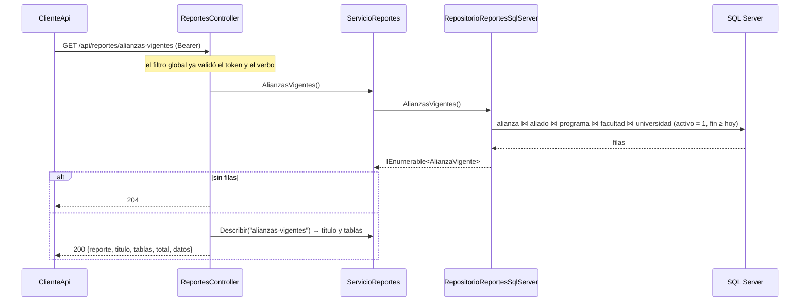

# Contratos HTTP — Versión 4

> Todas las rutas son **GET** y exigen JWT (401 sin token). Las ven los tres
> roles, porque el filtro global deja leer a todos. Errores con el sobre de
> siempre: `{estado, mensaje, detalle}`. La documentación interactiva está en
> `/swagger`.

## 1. `GET /api/reportes` — el catálogo

**200**
```json
{ "total": 10,
  "datos": [ { "ruta": "programas-acreditados", "titulo": "Programas acreditados",
               "descripcion": "Cada acreditación vigente con su programa, su facultad y su sede.",
               "tablas": ["acreditacion", "programa", "facultad", "universidad"] }, … ] }
```

## 2. `GET /api/reportes/{ruta escrita}` — los 10 reportes

Sobre común:

| Código | Cuerpo |
|---|---|
| **200** | `{ reporte, titulo, tablas: [...], total, datos: [ filas ] }` |
| **204** | El reporte no tiene filas con los datos actuales |
| **401** | Sin token o token vencido |
| **500** | `{estado:500, mensaje, detalle}` |

Columnas de `datos` por reporte (JSON en camelCase):

| Ruta | Columnas |
|---|---|
| `programas-acreditados` | universidad, ciudad, facultad, programa, nivel, resolucion, tipoAcreditacion, calificacion, desde, hasta |
| `registros-con-enfoques` | facultad, programa, registro, metodologia, vigenteHasta, cantidadEnfoques, enfoques *(texto, separados por coma)* |
| `plan-de-estudios` | programa, registro, actividad, creditos, componente, semestre, idioma |
| `areas-por-facultad` | facultad, granArea, programas, areas |
| `innovacion-por-programa` | facultad, programa, caracteristicas, practicas |
| `alianzas-vigentes` | aliado, ciudadAliado, programa, facultad, sede, desde, hasta *(null = sin fin)*, docente |
| `normatividad-por-programa` | norma, tipo, fuente, programa, facultad |
| `internacionalizacion` | facultad, programa, pasantias, paisesPasantia, premios, ultimoPremio |
| `docentes-por-sede` | sede, facultad, dedicacion, docentes |
| `cursos-espejo` | actividad, creditos, idioma, entidadEspejo, paisEspejo, programa, facultad, sede |

Ejemplo, `GET /api/reportes/cursos-espejo`:
```json
{ "reporte": "cursos-espejo", "titulo": "Cursos espejo internacionales",
  "tablas": ["activ_academica", "programa", "facultad", "universidad"], "total": 5,
  "datos": [ { "actividad": "Arquitectura de software", "creditos": 4, "idioma": "Español",
               "entidadEspejo": "Universidad de Chile", "paisEspejo": "Chile",
               "programa": "Maestría en Ingeniería de Software",
               "facultad": "Facultad de Ingeniería", "sede": "Bogotá" }, … ] }
```

## 3. `GET /api/dashboard/resumen`

**200**
```json
{ "facultades": 6, "programas": 12, "acreditaciones": 7, "registrosCalificados": 12,
  "actividadesAcademicas": 14, "docentes": 15, "alianzas": 8, "pasantias": 7,
  "premios": 5, "graduados": 14472 }
```

## 4. `GET /api/dashboard/{serie escrita}` — las 6 series

| Ruta | Etiqueta | Valor |
|---|---|---|
| `programas-por-nivel` | nivel | programas activos |
| `programas-por-sede` | ciudad de la sede | programas activos |
| `acreditaciones-por-calificacion` | calificación | acreditaciones activas |
| `registros-por-metodologia` | metodología | registros activos |
| `docentes-por-dedicacion` | dedicación | vinculaciones activas |
| `graduados-por-facultad?maximo=6` | facultad (o «Otras») | suma de graduados |

| Código | Cuerpo |
|---|---|
| **200** | `{ grafico, total, datos: [ { etiqueta, valor } ] }`, ordenado de mayor a menor. `total` = suma de los valores |
| **204** | Sin datos |
| **400** | `maximo` menor que 1 |
| **401** | Sin token |

## 5. Front: rutas públicas y protegidas

| Ruta | Sin sesión | Con sesión |
|---|---|---|
| `/` `/servicios` `/nosotros` `/soporte` `/contacto` | 200 (estática) | 200 |
| `/ingresar` | 200 | 200 |
| `/aplicacion` `/reportes` `/dashboard` y todas las de datos | 302 → `/ingresar?ReturnUrl=…` | 200 |
| `/manifest.webmanifest` `/service-worker.js` `/offline.html` | 200 | 200 |

## 6. Un reporte, dibujado


